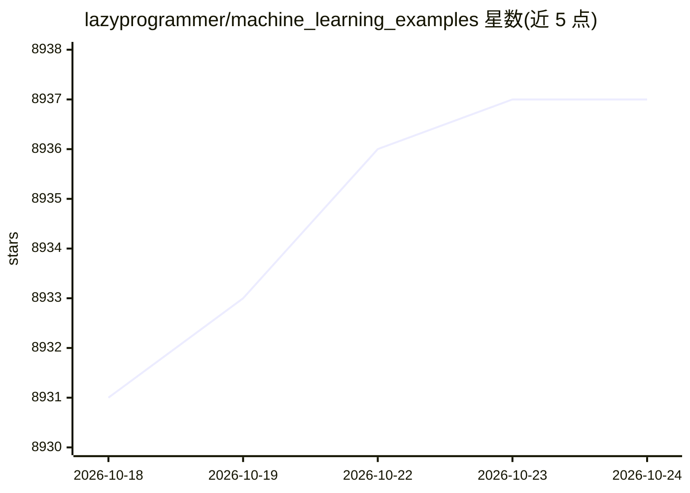

# lazyprogrammer/machine_learning_examples

⭐ 8,940 · Python · 推送 2026-09-28 · [GitHub](https://github.com/lazyprogrammer/machine_learning_examples) · [官网](https://lazyprogrammer.me) · 个人维护

**机器学习课程配套代码示例集（Python 教学用）**

LazyProgrammer 付费课程的代码示例仓库：按文件夹组织，一个文件夹对应一门课程，覆盖深度学习、强化学习、NLP、计算机视觉、贝叶斯方法等主题，配套教程见 lazyprogrammer.me、课程见 deeplearningcourses.com。README 说明 TensorFlow 2.0 起的新代码多在 Google Colab 中提供，仓库不含全部课程代码；建议 clone 而非 fork 以便 git pull 获取更新。内容与课程绑定，README 本身不含独立运行说明。

## 筛选速览

| 维度 | 判定 | 备注 |
|---|---|---|
| AI 角色 | `ai-knowledge` | 知识聚合/清单类 |
| 许可风险 | `none` | — |
| 部署形态 | `None` |  |
| 模型依赖 | — | README 未给出锁定关系 |
| 硬件要求 | — | 无带数字的原话,不猜 |
| 安装摩擦 | `low` | 无编译、无系统依赖或容器化 |
| 成熟度 | — | 结构信号不足 |

## 能力要点

- 按文件夹组织，一文件夹对应一门课程
- 覆盖深度学习、强化学习、NLP、时间序列等课程代码
- TensorFlow 2 起较新代码改为 Google Colab 笔记本形式

## 适用场景

- 我在学习 lazyprogrammer 课程时查找对应章节代码
- 跟随配套教程练习机器学习算法实现
- clone 后用 git pull 持续同步课程代码更新

## 场景标签

`教程课程` · 领域:学习与行业

## 证据(README 行号)

> L3: A collection of machine learning examples and tutorials.
> L15: Remember: one folder = one course.

## 星数曲线

2026-10-18 8,931 → 2026-10-24 8,937（+6）

---
*卡片 v1 · prompt 1.4 · 生成 2026-10-21 · 置信度 high · 依据 README sha `46fec014b33f` · [字段定义](../../DATASET.md)*
