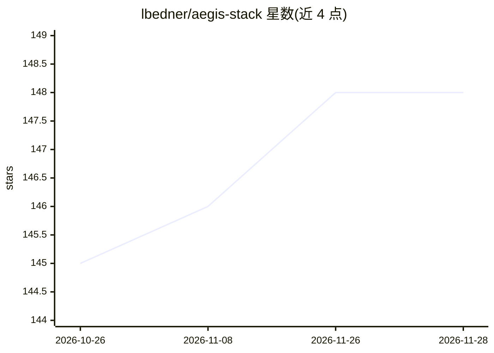

# lbedner/aegis-stack

⭐ 148 · Python · MIT · 推送 2026-11-27 · [GitHub](https://github.com/lbedner/aegis-stack) · [官网](https://aegis-stack.io) · 个人维护

**生成含 AI 能力的 FastAPI 全栈应用脚手架与控制平面**

基于 Copier 模板的 Python 项目生成器：一条命令产出已连通的 FastAPI 应用（API、worker、调度器、数据库、auth、AI），组件与服务可事后增删且改动按合并处理。附带 Twin（从代码与运行状态建模）、Overseer 控制平面（系统地图、部署、错误与成本）与 Illiana 对话操作员，CI 校验规则违规。部署面向自有 Hetzner/DigitalOcean 账户，走 rsync+Docker。README 以英文撰写，CLI 支持 9 种语言含简繁中文。

## 筛选速览

| 维度 | 判定 | 备注 |
|---|---|---|
| AI 角色 | `ai-enhanced` | 去掉 AI 部分产品仍成立 |
| 许可风险 | `permissive` | MIT |
| 部署形态 | `self-host` | docker 或自建部署 |
| 模型依赖 | local-ok | 支持本地模型 |
| 硬件要求 | — | 无带数字的原话,不猜 |
| 安装摩擦 | `low` | 无编译、无系统依赖或容器化 |
| 成熟度 | — | 结构信号不足 |

## 能力要点

- uvx 一条命令生成 FastAPI 全栈应用，组件/服务可增可删并合并编辑
- Inference 组件支持 Ollama 或 llama.cpp 本地模型，Kokoro 语音与 speaches 语音识别
- AI 服务提供对话 agent、RAG、模型目录、TTS/STT（PydanticAI/LangChain 跨 7 家供应商）
- Overseer 控制平面可视化系统运行状态，数据经 MCP 暴露给 agent

## 适用场景

- 快速生成带计费与登录的 SaaS MVP 项目骨架
- 生成接入本地 Ollama 模型的应用
- 用 Overseer 集中查看应用错误、任务、部署与成本
- 让 coding agent 通过 MCP 调用应用自身的工具

## 场景标签

 · 领域:开发者工具/应用框架

## 证据(README 行号)

> L28: Aegis Stack gives you a complete FastAPI app, wired and running: API, workers, scheduler, database, auth and AI, wi
> L103: **Components** are infrastructure pieces (database, workers, scheduler, cache). **Services** are business capabili
> L144: |**AI**|Conversational agents, RAG, model catalog, TTS and STT (PydanticAI / LangChain across 7 providers)|Optiona

## 星数曲线

2026-10-26 145 → 2026-11-28 148（+3）

---
*卡片 v1 · prompt 1.4 · 生成 2026-11-28 · 置信度 low · 依据 README sha `db759c10d9a1` · [字段定义](../../DATASET.md)*
