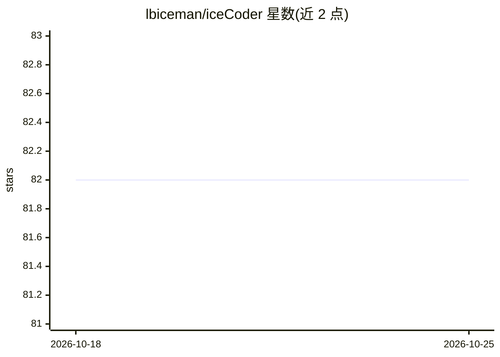

# lbiceman/iceCoder

⭐ 82 · TypeScript · MIT · 推送 2026-10-20 · [GitHub](https://github.com/lbiceman/iceCoder) · 个人维护 · 中文 README

**自托管 AI 编程 agent，桌面与移动 UI，L0/L1/L3 监管**

基于 Node.js 22+ / TypeScript 的自托管 AI 编程 agent，提供 Windows 一键安装版（Electron 外壳）、CLI tgz 与源码运行三种途径，同一 bundle 支持 Mobile H5 页面。核心机制包括单轴三层监管（L0 侧边栏档位 / L1 Harness 自由-强制切换与 ToolGate / L3 TaskGraph 硬性拦截）、Harness 循环将模型意图转为工具执行、并行子 agent 与写租约、Markdown 文件长期记忆（无外部向量库）、定时任务与 Agent Skills。API 走 OpenAI 兼容路径，可配置多个模型与推理强度；旧 L2 层已于 2026-08-31 移除。

## 筛选速览

| 维度 | 判定 | 备注 |
|---|---|---|
| AI 角色 | `ai-native` | 本体是模型或模型工具 |
| 许可风险 | `permissive` | MIT |
| 部署形态 | `library` | 以包/库形式分发 |
| 模型依赖 | — | README 未给出锁定关系 |
| 硬件要求 | — | 无带数字的原话,不猜 |
| 安装摩擦 | `low` | 无编译、无系统依赖或容器化 |
| 成熟度 | — | 结构信号不足 |

## 能力要点

- L0/L1/L3 单轴三层监管，绑定 TaskGraph 与停止时验证
- Harness 循环 + 并行子 agent（写租约、后台运行、检查点回滚）
- Markdown 文件记忆系统，无外部向量库，带意图感知召回与淘汰机制
- OpenAI 兼容 API，多模型逗号配置、推理强度与视觉支持切换

## 适用场景

- 在桌面或手机上通过对话让 agent 编辑代码、跑命令与验证
- 用监管档位控制 agent 在工程任务中的自由度与风险拦截
- 设置定时任务让 agent 无人值守跑周期性工作
- 用 Skills 和文件记忆沉淀可复用的工作习惯与项目事实

## 场景标签

`编码 Agent` · 领域:编码与开发

## 证据(README 行号)

> L3: **Self-hosted AI coding agent for desktop and mobile.** Single-axis supervision (L0/L1/L3), sub-agents, scheduled ta
> L167: - **API**: OpenAI-compatible. Default path `/v1/chat/completions`, optional `/v1/responses`.

## 星数曲线

2026-10-18 82 → 2026-10-25 82（+0）

---
*卡片 v1 · prompt 1.4 · 生成 2026-10-24 · 置信度 high · 依据 README sha `24e8a9f988d9` · [字段定义](../../DATASET.md)*
