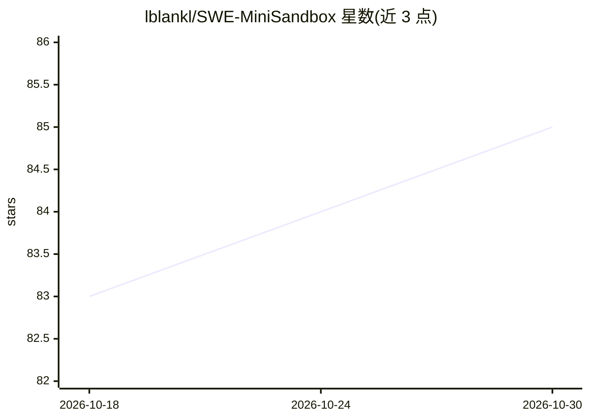

# lblankl/SWE-MiniSandbox

⭐ 85 · Python · 推送 2026-06-24 · [GitHub](https://github.com/lblankl/SWE-MiniSandbox) · [官网](https://lblankl.github.io/SWE-MiniSandbox/) · 组织维护

**免容器 RL 训练框架：隔离并训练软件工程 agent**

用于软件工程（SWE）agent 强化学习训练的框架：通过 Linux namespaces、chroot 与 bind mounts 构建相互隔离的沙箱环境，在其中运行批量 SWE agent 交互并计算基于执行的奖励；Python 环境用 venv 隔离、由多版本 Conda 管理。支持多节点 on-policy RL 训练，不依赖 Kubernetes 等容器编排。作者报告其训练性能与 Docker 方案相当（SWE-bench / SWE-agent-LM-7B、1600 样本 200 步实验）。需 Linux（Ubuntu 20.04+ 推荐）且要求 unshare/mount 命令可用；提供 Docker 镜像与手动安装两种方式，基于 SWE-agent、SWE-smith、SkyRL 等项目构建，附 arXiv 论文与 WandB 训练演示。

## 筛选速览

| 维度 | 判定 | 备注 |
|---|---|---|
| AI 角色 | `ai-ecosystem` | LLM/agent 周边工具 |
| 许可风险 | `none` | — |
| 部署形态 | `None` |  |
| 模型依赖 | — | README 未给出锁定关系 |
| 硬件要求 | — | 无带数字的原话,不猜 |
| 安装摩擦 | `low` | 无编译、无系统依赖或容器化 |
| 成熟度 | — | 结构信号不足 |

## 能力要点

- 基于 Linux namespaces/chroot/bind mounts 的免容器批量沙箱隔离
- 计算基于执行的奖励，支持多节点 on-policy RL 训练
- 无需 Kubernetes 或容器编排系统
- 作者报告与 Docker 方案训练性能相当的对比实验

## 适用场景

- 在 Linux 服务器上批量训练 SWE agent 而不依赖容器编排
- 为软件工程 agent 计算基于执行的 RL 奖励
- 多节点开展 on-policy 强化学习训练

## 场景标签

`强化学习` `Agent 框架` · 领域:Agent 开发

## 证据(README 行号)

> L14: SWE-MiniSandbox is a lightweight, container-free framework for isolating batched SWE agent interactions and computi
> L16: The framework relies on Linux namespaces, `chroot`, and bind mounts to create secure and efficient environments whe

## 星数曲线

2026-10-18 83 → 2026-10-30 85（+2）

---
*卡片 v1 · prompt 1.4 · 生成 2026-10-24 · 置信度 high · 依据 README sha `80661b725a08` · [字段定义](../../DATASET.md)*
