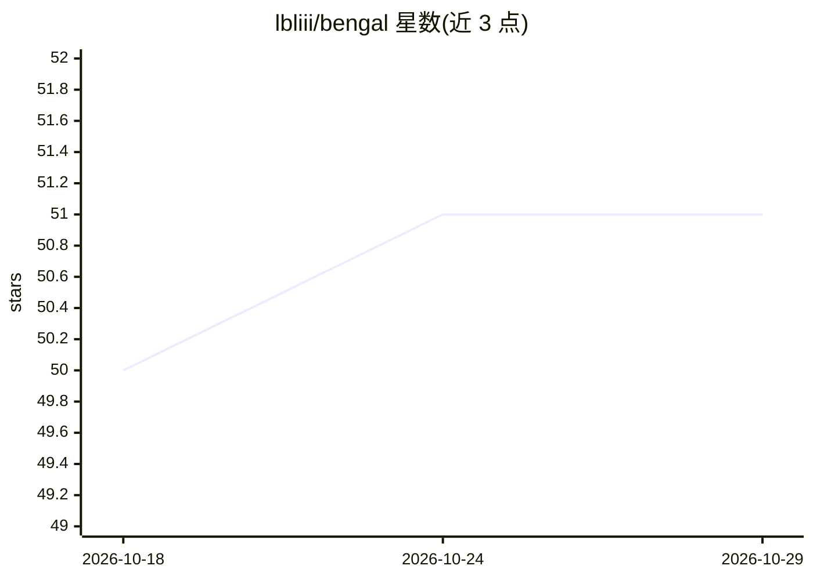

# lbliii/bengal

⭐ 51 · Python · MIT · 推送 2026-08-17 · [GitHub](https://github.com/lbliii/bengal) · [官网](https://lbliii.github.io/bengal/) · 个人维护

**Python 3.14+ 免费线程化的静态文档/站点生成器**

纯 Python 实现的静态站点生成器，解析、高亮、模板、开发服务器各层均自研（Patitas/Kida/Rosettes/Pounce），面向 Python 3.14+ 免费线程构建，无 npm 依赖。功能含并行构建、增量重建、Jupyter 渲染、Python/CLI/OpenAPI autodoc、内容校验、断链检测与零配置部署。面向写文档/博客/知识库的开发者与写作者；限制：需 Python 3.14+，自称 Alpha 且明确不承诺向后兼容。

## 筛选速览

| 维度 | 判定 | 备注 |
|---|---|---|
| AI 角色 | `ai-enhanced` | 去掉 AI 部分产品仍成立 |
| 许可风险 | `permissive` | MIT |
| 部署形态 | `library` | 以包/库形式分发 |
| 模型依赖 | — | README 未给出锁定关系 |
| 硬件要求 | — | 无带数字的原话,不猜 |
| 安装摩擦 | `low` | 无编译、无系统依赖或容器化 |
| 成熟度 | `idea` | |

## 能力要点

- 并行构建与基于溯源哈希的增量重建
- 生成 llms.txt、agent manifests、逐页 JSON 与 Content Signals 供 AI agent 发现内容
- Python/CLI/OpenAPI 三类 autodoc 与 Jupyter .ipynb 原生渲染
- 模板/Markdown/高亮引擎可插拔，六个插件扩展点

## 适用场景

- 为 Python 项目生成版本化文档与 API 参考
- 搭建带搜索、校验与 AI 可读输出的知识库
- 写博客/作品集并自动部署到 GitHub Pages 等平台

## 场景标签

 · 领域:开发者工具/文档生成

## 证据(README 行号)

> L9: **The documentation generator built on Python's free-threading future**
> L25: - **AI-native output** — Generates llms.txt, agent manifests, per-page JSON, and Content Signals so AI agents can d

## 星数曲线

2026-10-18 50 → 2026-10-29 51（+1）

---
*卡片 v1 · prompt 1.4 · 生成 2026-10-24 · 置信度 high · 依据 README sha `0809e6abe621` · [字段定义](../../DATASET.md)*
