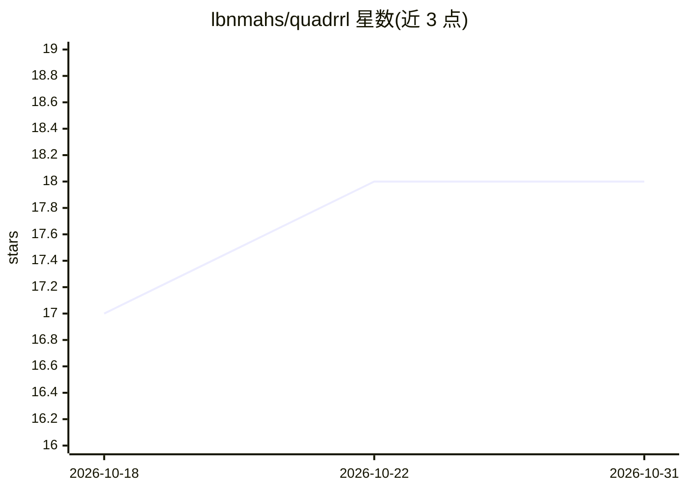

# lbnmahs/quadrrl

⭐ 18 · Jupyter Notebook · BSD-3-Clause · 推送 2026-09-17 · [GitHub](https://github.com/lbnmahs/quadrrl) · 个人维护

**四足机器人运动控制 DRL 训练与评测套件**

基于 NVIDIA Isaac Sim / Isaac Lab 的四足（含轮足）机器人运动学习库：提供覆盖平坦与崎岖地形的深度强化学习速度跟踪训练任务，支持 Anymal C/D、Spot、Unitree Go2/B2 等 11 种机型环境，并含多形态对比性能分析 notebook。训练后端支持 RSL-RL（默认 PPO）、RL Games、SKRL、HARL（多智能体）。要求 NVIDIA CUDA GPU（建议 RTX 3060 以上）、Python 3.10+，在 Linux/Windows 上以源码方式安装。

## 筛选速览

| 维度 | 判定 | 备注 |
|---|---|---|
| AI 角色 | `ai-ecosystem` | LLM/agent 周边工具 |
| 许可风险 | `permissive` | BSD-3-Clause |
| 部署形态 | `None` |  |
| 模型依赖 | — | README 未给出锁定关系 |
| 硬件要求 | — | 无带数字的原话,不猜 |
| 安装摩擦 | `medium` | 含编译或系统依赖之一 |
| 成熟度 | — | 结构信号不足 |

## 能力要点

- 11 种四足/轮足机器人环境（Anymal、Spot、Unitree Go2/B2 等）
- 平坦与崎岖地形的 DRL 速度跟踪训练任务
- 支持 RSL-RL/RL Games/SKRL/HARL 四种训练框架
- 附带 rsl_rl 与轮足对比性能分析 notebook

## 适用场景

- 我在 Isaac Lab 中训练四足机器人行走控制策略
- 对比不同机型或轮足形态的运动学习性能
- 评测不同 RL 框架下的四足运动任务表现

## 场景标签

`强化学习` `模型评测` · 领域:评测与运维

## 证据(README 行号)

> L14: **Quadrrl** is a training and benchmarking library for both legged and wheeled-legged quadruped robots. It includes
> L49: - **Notebooks** - Performance analysis with `rsl_rl_performance.ipynb` (Table I) and `legged_vs_wheeled_performance

## 星数曲线

2026-10-18 17 → 2026-10-31 18（+1）

---
*卡片 v1 · prompt 1.4 · 生成 2026-10-29 · 置信度 high · 依据 README sha `9e7d058f7a02` · [字段定义](../../DATASET.md)*
