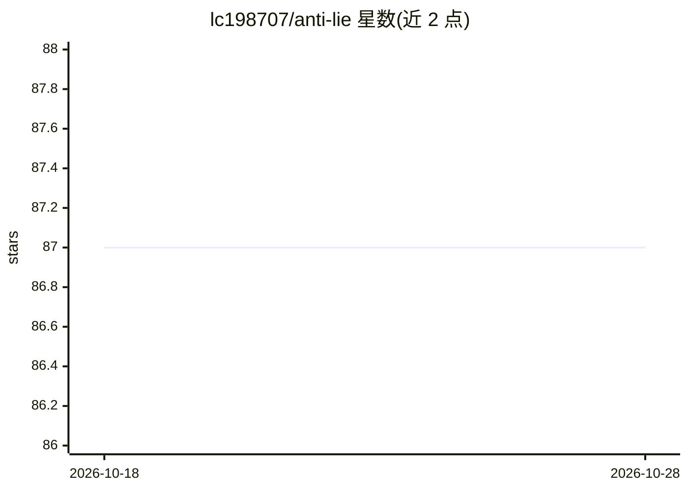

# lc198707/anti-lie

⭐ 87 · Python · NOASSERTION · 推送 2026-05-10 · [GitHub](https://github.com/lc198707/anti-lie) · [官网](https://github.com/lc198707/anti-lie) · 个人维护 · 中文 README

**LLM 出站声明审计层：逐句核验事实声明并打 T1-T7 真值标签**

以 OpenClaw 出站 hook 形式分发的审计层：在回答离开系统前切分句子、抽取事实声明，将数字/实体/日期等断言与回执（工具调用、RAG 片段、用户材料等）匹配，输出 T1-T7 七级判定——绿标放行、黄标带警告标签、T5 红标阻断（Fail-Closed）。含 Python 校验服务、Node.js shadow worker 与 Linux/macOS 服务定义，通过 install.sh 安装。限制：README 标注所有公开基准数字为占位、计划于 v0.2.0 实测；基准数据集 LiarBench 为自建且尚未公开发布。

## 筛选速览

| 维度 | 判定 | 备注 |
|---|---|---|
| AI 角色 | `ai-ecosystem` | LLM/agent 周边工具 |
| 许可风险 | `permissive` | NOASSERTION |
| 部署形态 | `None` |  |
| 模型依赖 | — | README 未给出锁定关系 |
| 硬件要求 | — | 无带数字的原话,不猜 |
| 安装摩擦 | `low` | 无编译、无系统依赖或容器化 |
| 成熟度 | — | 结构信号不足 |

## 能力要点

- T1-T7 真值分级：工具验证/RAG 接地/用户材料绿标，推论/常识/推测黄标，无回执硬事实 T5 红标阻断
- 以 OpenClaw 出站 hook 形式部署，不拦截思考过程，只审计待交付文本
- 策略文件可配置 Fail-Closed/Warn-Only、风险类别、新鲜度窗口与升级规则
- 五类回执适配器：日志读取、RAG、web、数据库、用户材料

## 适用场景

- 在客服、金融、医疗、法务等场景上线前拦截无出处的硬事实声明
- 为 RAG/工具调用回答附加可审计的出处标签
- 在低风险环境中将红标降级为确认请求而非直接发布

## 场景标签

`LLM 可观测性` · 领域:评测与运维

## 证据(README 行号)

> L58: Anti-Lie is distributed as an OpenClaw outbound hook bundle that includes a Python verifier service, a Node.js shad
> L73: 1. **Hook placement.** Anti-Lie lives in the OpenClaw skill/hook location and loads with the runtime. It should not
> L80: This approach means Anti-Lie does not require you to replace LangChain, OpenAI Agents, RAG pipelines, observability

## 星数曲线

2026-10-18 87 → 2026-10-28 87（+0）

---
*卡片 v1 · prompt 1.4 · 生成 2026-10-23 · 置信度 high · 依据 README sha `a242c64512dd` · [字段定义](../../DATASET.md)*
