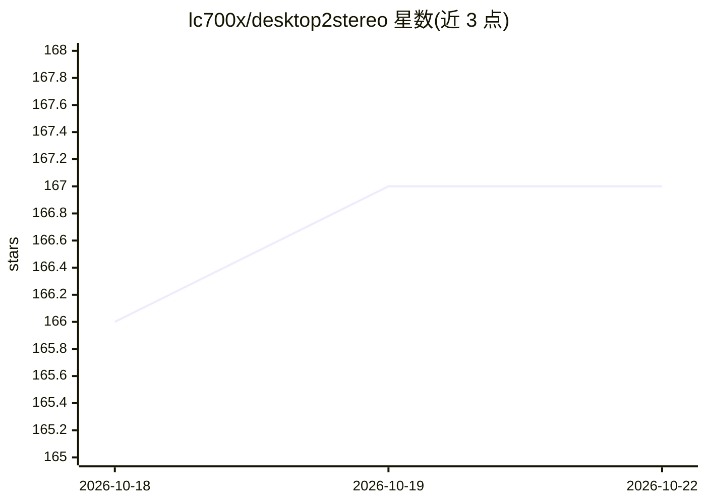

# lc700x/desktop2stereo

⭐ 167 · Python · MIT · 推送 2026-07-31 · [GitHub](https://github.com/lc700x/desktop2stereo) · 个人维护 · 中文 README

**实时把 2D 桌面画面转为 3D 立体显示的 AI 深度应用**

跨平台桌面应用，用深度估计 AI 模型实时将捕获的显示器/窗口画面转为立体 3D 输出，供 VR/AR 头显、AR 眼镜或 3D 显示器观看。支持 AMD/NVIDIA/Intel/Qualcomm GPU 与 Apple Silicon，覆盖 Windows 10/11、macOS 与 Ubuntu 22.04+。运行模式包括 OpenXR Link 无线串流、本地立体查看器（Half-SBS/Full-SBS/TAB）、MJPEG/RTMP 串流与 3D 显示器模式，提供 VR 手柄快捷键、黑边裁剪与深度强度实时调节。以便携版 zip 下载与 Python 环境脚本两种方式安装，AMD ROCm7 设备需走手动部署流程。

## 筛选速览

| 维度 | 判定 | 备注 |
|---|---|---|
| AI 角色 | `ai-native` | 本体是模型或模型工具 |
| 许可风险 | `permissive` | MIT |
| 部署形态 | `desktop` | 安装包/桌面程序 |
| 模型依赖 | — | README 未给出锁定关系 |
| 硬件要求 | — | 无带数字的原话,不猜 |
| 安装摩擦 | `medium` | 含编译或系统依赖之一 |
| 成熟度 | — | 结构信号不足 |

## 能力要点

- 深度估计模型实时生成 2D→3D 立体画面
- 支持 AMD/NVIDIA/Intel/Qualcomm GPU 与 Apple Silicon，跨 Windows/macOS/Ubuntu
- OpenXR Link 模式无线串流至 Virtual Desktop VDXR / Meta Horizon Link / Pico Connect
- VR 手柄快捷键体系：屏幕位置/深度调节/虚拟键盘/黑边裁剪

## 适用场景

- 在 VR 头显中以大屏 3D 方式观看桌面电影或游戏
- 把 PC 桌面无线串流到 Quest/Pico 等 OpenXR 设备
- 通过 AR 眼镜的 Full-SBS 模式查看 3D 桌面画面

## 场景标签

`图像视频处理` · 领域:感知与多模态

## 证据(README 行号)

> L8: A universal real-time 2D to 3D App that supports AMD/NVIDIA/Intel/Qualcomm GPU/Apple Silicon devices on Windows/Mac/
> L23: ## Supported Hardware
> L25: 1. AMD GPU

## 星数曲线

2026-10-18 166 → 2026-10-22 167（+1）

---
*卡片 v1 · prompt 1.4 · 生成 2026-10-22 · 置信度 high · 依据 README sha `d4a3e519f0f5` · [字段定义](../../DATASET.md)*
