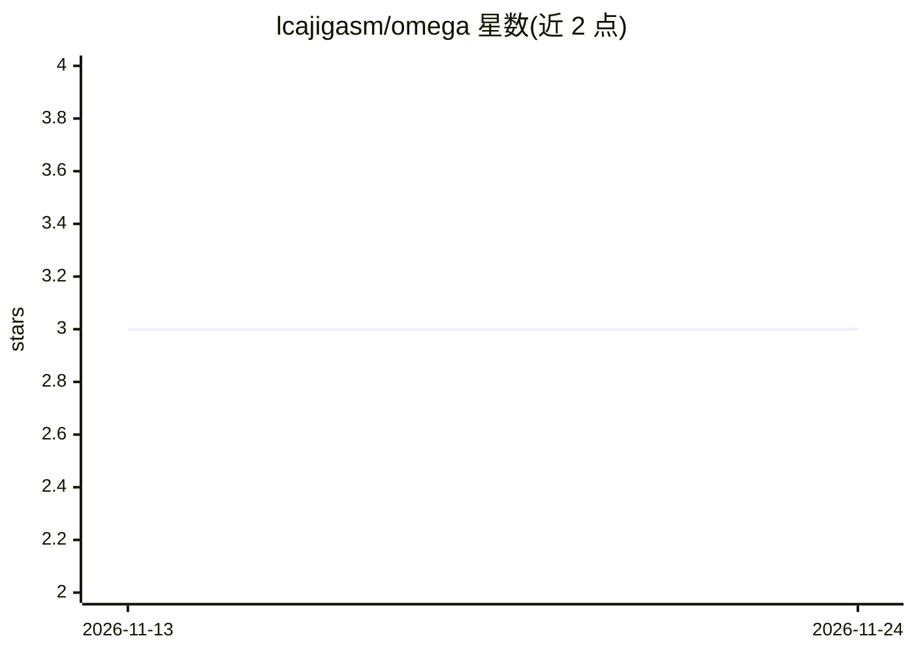

# lcajigasm/omega

⭐ 3 · Go · MIT · 推送 2026-11-23 · [GitHub](https://github.com/lcajigasm/omega) · [官网](https://lcajigasm.github.io/omega/) · 个人维护

**AI 驱动的跨平台系统维护 CLI：更新、清理并自动修复失败步骤**

用 Go 编写的系统维护工具，覆盖 macOS/Linux/Windows：更新包管理器（Homebrew/apt/winget/npm 等）、清理缓存与磁盘、健康检查与安全审计。当步骤失败时读取错误、定位原因、应用最小修复并重试一次。命令按风险分级审批，支持 --offline 离线运行。提供 CLI、TUI、桌面应用与 Docker 镜像，内置 MCP server 供其他 AI agent 调用其命令。例行任务用小模型，失败时切换到更强模型。

## 筛选速览

| 维度 | 判定 | 备注 |
|---|---|---|
| AI 角色 | `ai-enhanced` | 去掉 AI 部分产品仍成立 |
| 许可风险 | `permissive` | MIT |
| 部署形态 | `desktop` | 安装包/桌面程序 |
| 模型依赖 | local-ok | 支持本地模型 |
| 硬件要求 | — | 无带数字的原话,不猜 |
| 安装摩擦 | `low` | 无编译、无系统依赖或容器化 |
| 成熟度 | — | 结构信号不足 |

## 能力要点

- 失败步骤自动诊断并应用最小修复，重试一次
- 命令按 5 级风险分类，危险命令必须逐次确认
- 内置 MCP server，供 Claude/Codex/Cursor/Gemini CLI 调用
- 支持 --no-ai / --offline 完全离线运行

## 适用场景

- 一台命令统一更新和清理三个操作系统的开发机
- 自动排查并修复 topgrade/pipx 等更新失败
- 清理 AI agent 会话遗留的进程与磁盘占用
- 通过定时任务无人值守执行安全维护

## 场景标签

`工作流自动化` · 领域:效率与自动化

## 证据(README 行号)

> L5: **AI-driven maintenance for macOS, Linux and Windows.**
> L120: |**For AI agents**|`omega mcp`|An MCP server, so Claude, Codex, Cursor and Gemini CLI use omega's commands and rea
> L43: > You can also run completely offline without an AI model using `omega --no-ai` or `omega --offline`.

## 星数曲线

2026-11-13 3 → 2026-11-24 3（+0）

---
*卡片 v1 · prompt 1.4 · 生成 2026-11-21 · 置信度 high · 依据 README sha `a2b9e54e0399` · [字段定义](../../DATASET.md)*
