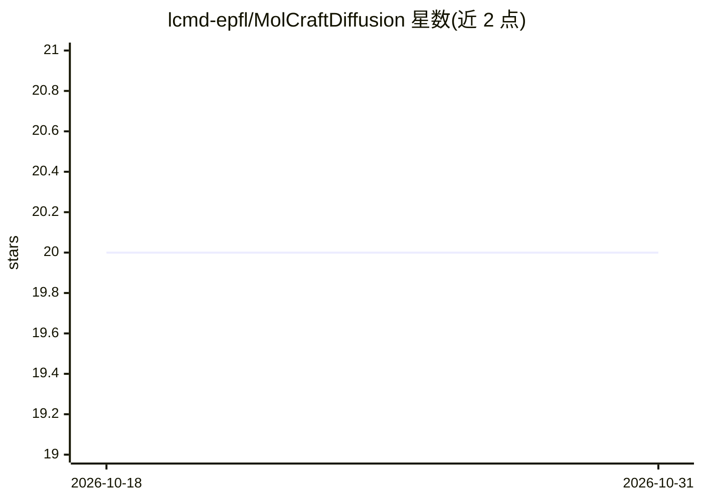

# lcmd-epfl/MolCraftDiffusion

⭐ 20 · Python · MIT · 推送 2026-09-28 · [GitHub](https://github.com/lcmd-epfl/MolCraftDiffusion) · [官网](https://pregHosh.github.io/MolCraftDiffusion/) · 组织维护

**3D 分子生成统一框架：训练、引导生成与评测一体化**

面向计算化学与药物设计的 3D 分子生成平台：将数据准备、训练与微调、引导生成、checkpoint 管理和评测统一在模块化架构与一致 CLI 之后，覆盖 de novo、性质导向、结构引导（inpainting/outpainting）、形状/口袋/药效团条件化、片段连接等多种生成范式，支持扩散与 flow-matching 骨干。提供模型 zoo（按名称解析权重与数据集）、分析套件（几何优化、有效性指标、量子化学描述符）、12 个教程，以及配套无代码 Web UI AutomaticMolCraft。预训练权重与数据集托管于 Zenodo 与 Hugging Face，zoo 仓库当前需 HuggingFace token 访问。

## 筛选速览

| 维度 | 判定 | 备注 |
|---|---|---|
| AI 角色 | `ai-native` | 本体是模型或模型工具 |
| 许可风险 | `permissive` | MIT |
| 部署形态 | `library` | 以包/库形式分发 |
| 模型依赖 | — | README 未给出锁定关系 |
| 硬件要求 | `cpu-ok` | |
| 安装摩擦 | `medium` | 含编译或系统依赖之一 |
| 成熟度 | — | 结构信号不足 |

## 能力要点

- 多种 3D 生成范式共用同一配置系统、CLI 与数据管线
- MolCraftDiff 统一入口：train/generate/predict/analyze/data
- 模型 zoo 按名称解析预训练权重、数据集与示例配置，sha256 校验
- 内置分析套件：结构验证、几何优化、电子性质与特征提取

## 适用场景

- 在虚拟库构建与逆设计中做性质导向的 3D 分子生成
- 基于蛋白口袋做结构导向的分子设计
- 在同一管线内训练、微调并对比多种 3D 生成模型
- 对生成分子做几何优化与有效性评测

## 场景标签

`微调` `模型评测` `科研工具` · 领域:评测与运维

## 证据(README 行号)

> L13: **One platform brings together a broad range of 3D molecular generators for de novo, property-directed, structure-g
> L21: - **De novo generation** of complete 3D molecules
> L104: |`generate`|Sample molecules from a trained model|

## 星数曲线

2026-10-18 20 → 2026-10-31 20（+0）

---
*卡片 v1 · prompt 1.4 · 生成 2026-10-28 · 置信度 high · 依据 README sha `c8b1fdda4607` · [字段定义](../../DATASET.md)*
