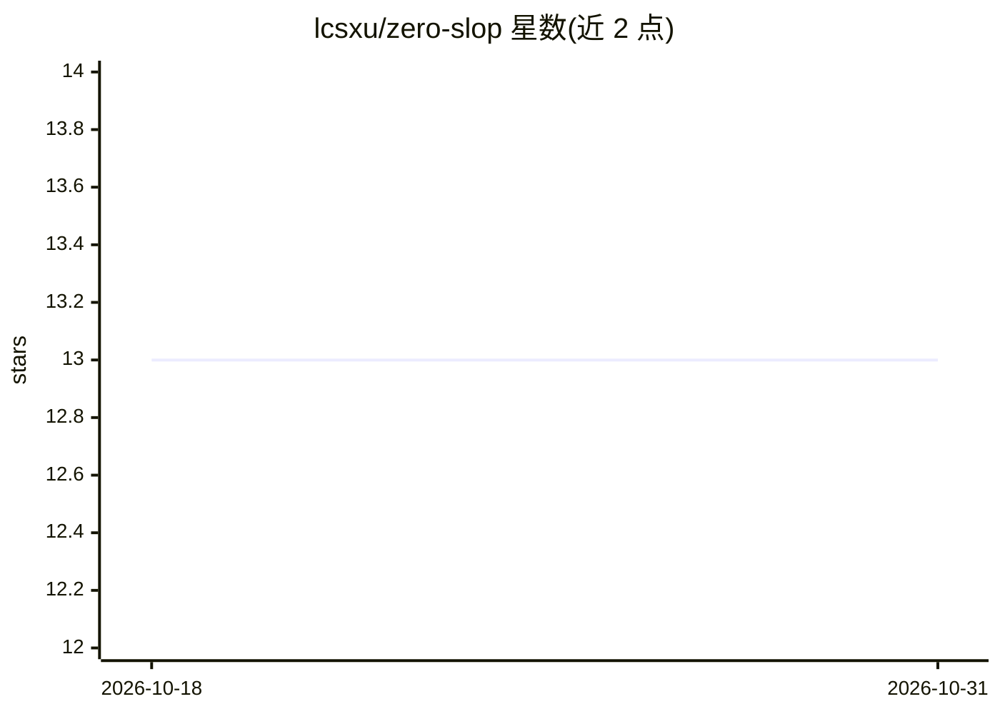

# lcsxu/zero-slop

⭐ 13 · Python · Apache-2.0 · 推送 2026-06-14 · [GitHub](https://github.com/lcsxu/zero-slop) · 个人维护

**给 AI 编码代理的五个前端设计质量技能包**

面向 AI 编码代理的技能（skills）集合，含五个组件：no-slop 审查前端代码中的通用 AI 套路模式并给出 0–100 评分与修复建议；perfect-design 在写码前产出设计契约并按 14 维度评分；perfect-ux 产出 UX 契约、映射用户旅程并按可用性准则审计；reality-skill 检查死按钮、占位数据等未完成流程；truth-serum 对弱前提与无据声明做证据审计。通过 npx skills add 安装后激活，支持 tsx/jsx/vue/svelte/css/html 文件，提供 --scan/--autopsy/--fix 等 CLI 命令与 0–10 严格度调节、多类预设。

## 筛选速览

| 维度 | 判定 | 备注 |
|---|---|---|
| AI 角色 | `ai-ecosystem` | LLM/agent 周边工具 |
| 许可风险 | `permissive` | Apache-2.0 |
| 部署形态 | `library` | 以包/库形式分发 |
| 模型依赖 | — | README 未给出锁定关系 |
| 硬件要求 | — | 无带数字的原话,不猜 |
| 安装摩擦 | `low` | 无编译、无系统依赖或容器化 |
| 成熟度 | — | 结构信号不足 |

## 能力要点

- no-slop 上下文感知扫描前端文件，输出 0–100 评分、AI UI Autopsy 报告与 6 角色评审
- perfect-design 以设计契约 + 6 种产品原型 + 14 维度评分约束 UI 方向
- perfect-ux 含基于 WCAG/WAI、Baymard 等研究背书的 UX 检查门与确定性 CLI 预检
- truth-serum 提供 red-team、premortem、证据审计等工作流并强制置信度标注

## 适用场景

- 审查 AI 生成的前端界面，去除通用套路化设计
- 在写码前为产品定义设计契约与 UX 契约
- 检查 demo 是否有死按钮、假数据等未完成流程
- 对方案的前提与证据强度做审计

## 场景标签

`代码审查` `提示工程` · 领域:Agent 开发

## 证据(README 行号)

> L7: Five agent skills to help your AI-generated interfaces feel like *your* product, work for real users, avoid generic 
> L74: npx skills add Eid0lon/zero-slop

## 星数曲线

2026-10-18 13 → 2026-10-31 13（+0）

---
*卡片 v1 · prompt 1.4 · 生成 2026-10-31 · 置信度 high · 依据 README sha `d575b816effd` · [字段定义](../../DATASET.md)*
