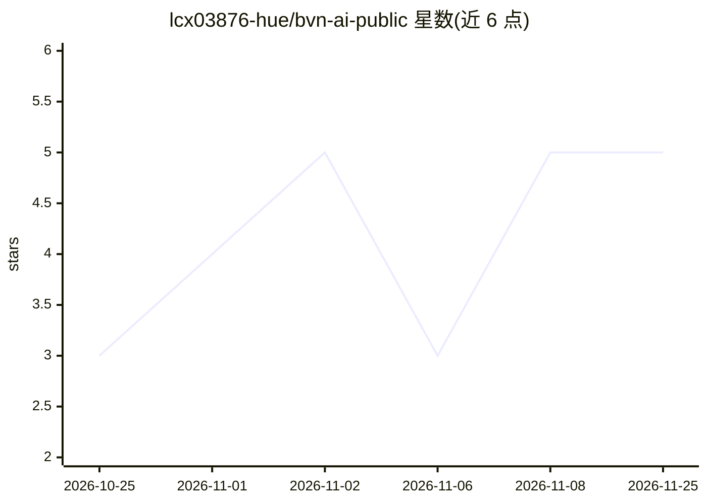

# lcx03876-hue/bvn-ai-public

⭐ 5 · Python · MIT · 推送 2026-10-23 · [GitHub](https://github.com/lcx03876-hue/bvn-ai-public) · 个人维护 · 中文 README

**给 Flash 格斗游戏死神vs火影构建完整可验证的 AI 对战循环**

针对 Flash/AIR 格斗游戏死神vs火影的 AI 项目：通过向反编译的 ActionScript 注入桥接代码，使游戏每帧写出双方状态 JSON 快照（无视觉、无内存扫描），随后完成数据采集、行为克隆 + DAgger + 保守离线 RL 训练、ONNX 导出与实时推理，以注入按键的方式操控真实游戏并可用叠加 HUD 展示决策。测试于 Windows 上的游戏 3.0.0 版本，用户需自备游戏文件；0.x 阶段观测布局、动作集与 CLI 参数可能在次版本间变更。

## 筛选速览

| 维度 | 判定 | 备注 |
|---|---|---|
| AI 角色 | `ai-native` | 本体是模型或模型工具 |
| 许可风险 | `permissive` | MIT |
| 部署形态 | `library` | 以包/库形式分发 |
| 模型依赖 | — | README 未给出锁定关系 |
| 硬件要求 | — | 无带数字的原话,不猜 |
| 安装摩擦 | `low` | 无编译、无系统依赖或容器化 |
| 成熟度 | `idea` | |

## 能力要点

- 注入 ActionScript 桥接读取每帧精确游戏状态（60 Hz）
- 行为克隆 + DAgger + 保守离线 RL 训练，导出 ONNX 推理
- 部署动作掩码避免不可执行操作（如气不足时变身）
- 双语 HUD 叠加层实时显示 AI 决策

## 适用场景

- 让 AI 在真实游戏中对战并录制对局过程
- 研究模仿学习与离线 RL 在真实游戏中的部署验证
- 为 Flash/AIR 游戏构建状态桥接而非像素读取的方案参考

## 场景标签

`强化学习` · 领域:训练与推理

## 证据(README 行号)

> L5: A complete, working AI stack for the Flash/AIR fighting game
> L7: **read state → collect → train → export → infer → inject input**, all verified
> L87: |4|Training|`train.py` (BC → offline-RL fine-tune)|✅|

## 星数曲线

2026-10-25 3 → 2026-11-25 5（+2）

---
*卡片 v1 · prompt 1.4 · 生成 2026-11-21 · 置信度 high · 依据 README sha `f198e0ae52b2` · [字段定义](../../DATASET.md)*
