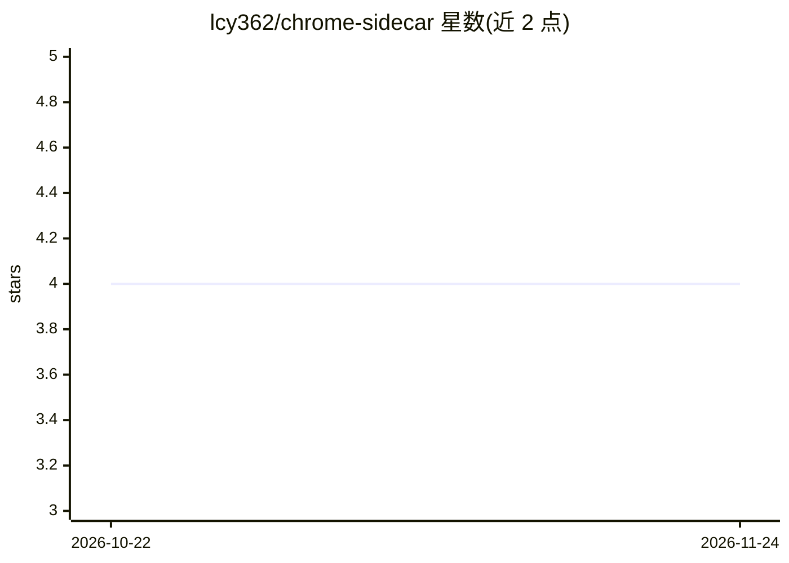

# lcy362/chrome-sidecar

⭐ 4 · JavaScript · MIT · 推送 2026-10-12 · [GitHub](https://github.com/lcy362/chrome-sidecar) · 个人维护 · 中文 README

**让 AI agent 操作你已登录 Chrome 的技能包**

以 SKILL.md 目录形式分发的 agent 技能，通过 CDP 驱动用户日常使用的 Chrome：在后台标签页运行、注入真实鼠标键盘事件、在密码/2FA/CAPTCHA 处停下并把控制权交还用户。支持 Claude Code、Cursor、Codex、Gemini CLI 等读取 skills 的 agent，经 flint 或手动复制安装，零运行时依赖，仅需 Node 22+ 与开启远程调试的浏览器。

## 筛选速览

| 维度 | 判定 | 备注 |
|---|---|---|
| AI 角色 | `ai-native` | 本体是模型或模型工具 |
| 许可风险 | `permissive` | MIT |
| 部署形态 | `library` | 以包/库形式分发 |
| 模型依赖 | — | README 未给出锁定关系 |
| 硬件要求 | — | 无带数字的原话,不猜 |
| 安装摩擦 | `low` | 无编译、无系统依赖或容器化 |
| 成熟度 | — | 结构信号不足 |

## 能力要点

- 后台标签页运行且不抢占前台焦点
- 真实鼠标键盘事件与拟人化时序（Bézier 轨迹、随机停顿）
- 人类接管协议：登录/验证码/支付确认处必须停下，永不读取密码字段
- 提供 ensureOn、uploadAndVerify、dismissModals 等任务正确性辅助函数

## 适用场景

- 让 agent 读取需要登录的仪表盘数据并汇总
- 让 agent 代为编辑和提交网页表单
- 涉及 2FA 或扫码登录的自动化流程中人工接管

## 场景标签

`浏览器自动化` `编码 Agent` · 领域:效率与自动化

## 证据(README 行号)

> L13: It ships as one `SKILL.md` directory, so it drops into any agent that reads skills — Claude Code,
> L31: A **Chrome skill** is an agent skill whose job is to *operate* a real Chrome — click, type, upload,
> L149: You do not drive the browser yourself. You ask your agent, in plain language, and this skill is

## 星数曲线

2026-10-22 4 → 2026-11-24 4（+0）

---
*卡片 v1 · prompt 1.4 · 生成 2026-11-21 · 置信度 high · 依据 README sha `74f29af68b83` · [字段定义](../../DATASET.md)*
