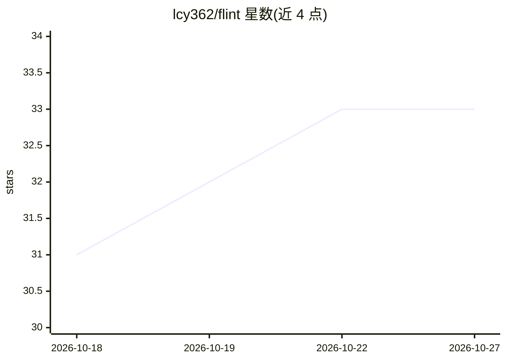

# lcy362/flint

⭐ 33 · TypeScript · MIT · 推送 2026-10-14 · [GitHub](https://github.com/lcy362/flint) · [官网](https://flint.lichuanyang.top) · 个人维护 · 中文 README

**本地优先的个人 AI 技能资产管理器：集中管理并分发 agent 技能**

面向使用多个 AI agent 的开发者的技能资产工具：把散落各处的技能（SKILL.md 目录）集中为本地磁盘上的纯文件库，提供统一打标（写入 frontmatter，兼容 Claude Code 等 40+ 工具读取）、过滤、去重，并通过 symlink/复制把技能部署到 agent 与项目目录；支持预设一键部署、项目级标签同步到 .agents/skills、6 维健康检查。核心机制是数据主权：无云端、无账号、无遥测，技能元数据遵循开放生态约定而非私有数据库。需要 Node.js ≥ 20，通过 npm/npx 安装，启动后于 localhost:8787 提供本地 Web UI。

## 筛选速览

| 维度 | 判定 | 备注 |
|---|---|---|
| AI 角色 | `ai-ecosystem` | LLM/agent 周边工具 |
| 许可风险 | `permissive` | MIT |
| 部署形态 | `library` | 以包/库形式分发 |
| 模型依赖 | — | README 未给出锁定关系 |
| 硬件要求 | — | 无带数字的原话,不猜 |
| 安装摩擦 | `low` | 无编译、无系统依赖或容器化 |
| 成熟度 | — | 结构信号不足 |

## 能力要点

- 技能以纯文件（SKILL.md 目录）形式存在于本地磁盘，无云/账号/遥测
- 标签写入 frontmatter，可被 Claude Code 等 40+ 工具原生读取
- symlink/复制两种方式部署技能到 agent 与项目目录
- 预设技能包一键部署与 6 维健康检查（重复/断链/同步等）

## 适用场景

- 在多个 agent 之间统一管理和分发同一套个人技能库
- 通过标签预设控制每个 agent/项目实际安装哪些技能，控制 token 开销
- 去重与修复同一技能在环境中产生的多份副本
- 用 git 管理技能库并在更换工具时零成本迁移

## 场景标签

`知识库管理` · 领域:知识与检索

## 证据(README 行号)

> L21: Flint is a local-first personal AI skills asset manager — it centralizes the skills used by all of your agents, wit
> L115: |**Library**|Browse / search / filter all skills; `SKILL.md` preview, tag editing, provenance; register / edit own
> L116: |**Agents**|One card per actual skill directory (agents sharing a directory merge into one card and share one stra

## 星数曲线

2026-10-18 31 → 2026-10-27 33（+2）

---
*卡片 v1 · prompt 1.4 · 生成 2026-10-25 · 置信度 high · 依据 README sha `2568c4055623` · [字段定义](../../DATASET.md)*
