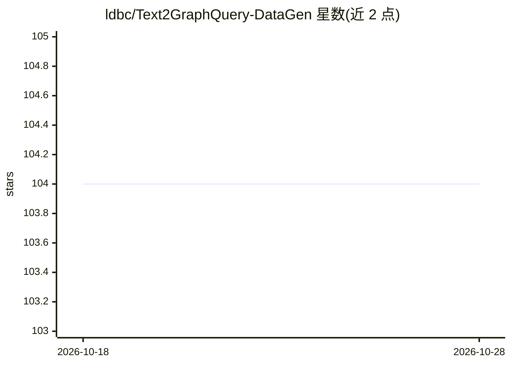

# ldbc/Text2GraphQuery-DataGen

⭐ 104 · Python · Apache-2.0 · 推送 2026-07-27 · [GitHub](https://github.com/ldbc/Text2GraphQuery-DataGen) · 组织维护 · 中文 README

**Text2GQL 微调数据集自动构建框架，覆盖多图查询语言**

AI 辅助的 Text2GQL（自然语言到图查询语言）数据集构建框架，提供翻译、泛化、生成三类能力：图查询语言之间的查询互译、问题多语言与多风格泛化、从自然语言领域描述自动生成图数据库 schema 与符合统计分布的仿真数据，并通过迭代增强产出多跳、嵌套等复杂 Question-Query 语料。支持 ISO-GQL、Cypher、Gremlin、SQL/PGQ 等，LLM 后端可选 DashScope、OpenAI 或基于 transformers 的本地模型。附带由该框架生成的 Text2GQL-Bench 数据集（178,184 对、13 领域）及 TuGraph-DB 中文 ChatBot 演示。面向需要构建图数据库问答/Text2GQL 微调数据的研究者与开发者。

## 筛选速览

| 维度 | 判定 | 备注 |
|---|---|---|
| AI 角色 | `ai-ecosystem` | LLM/agent 周边工具 |
| 许可风险 | `permissive` | Apache-2.0 |
| 部署形态 | `library` | 以包/库形式分发 |
| 模型依赖 | — | README 未给出锁定关系 |
| 硬件要求 | — | 无带数字的原话,不猜 |
| 安装摩擦 | `low` | 无编译、无系统依赖或容器化 |
| 成熟度 | — | 结构信号不足 |

## 能力要点

- 支持 ISO-GQL、Cypher、Gremlin、SQL/PGQ 等多种图查询语言的语料翻译与生成
- 从自然语言领域描述自动生成图 schema 及符合幂律/长尾/正态分布的仿真数据
- LLM 后端支持 DashScope（Qwen）、OpenAI 与基于 transformers 的本地模型
- 附带生成的 Text2GQL-Bench 基准（178,184 对 Question-Query，13 领域）

## 适用场景

- 为图数据库问答模型构建 Text2GQL 微调语料，降低人工标注成本
- 把 Neo4j 的 Text2Cypher 语料翻译为 ISO-GQL 语法的 Text2GQL 语料
- 自动生成图数据库测试 schema 与仿真数据实例
- 将英文问题语料翻译为中文以扩展多语言语料

## 场景标签

`微调` `模型评测` · 领域:评测与运维

## 证据(README 行号)

> L12: Awesome-Text2GQL is an AI-assisted framework for Text2GQL dataset construction. The framework supports translation,
> L305: Awesome-Text2GQL use Translator, Generalizer and Generator to assit the entire process of Text2GQL dataset constru

## 星数曲线

2026-10-18 104 → 2026-10-28 104（+0）

---
*卡片 v1 · prompt 1.4 · 生成 2026-10-23 · 置信度 high · 依据 README sha `56e8ea691d9b` · [字段定义](../../DATASET.md)*
