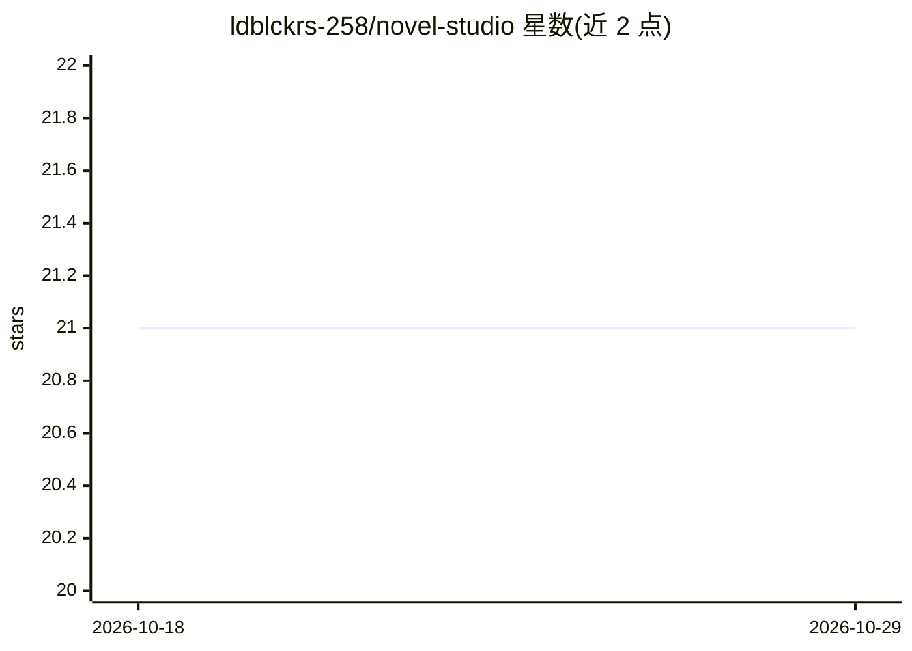

# ldblckrs-258/novel-studio

⭐ 21 · TypeScript · MIT · 推送 2026-09-29 · [GitHub](https://github.com/ldblckrs-258/novel-studio) · [官网](https://novel-studio-kappa.vercel.app) · 个人维护

**面向越南语作者与译者的本地优先 AI 小说创作工作台**

运行于浏览器的创作工作台，小说、章节、角色、笔记等数据存于 IndexedDB，无需账号与后端。AI 功能包括多供应商聊天（OpenAI、Anthropic、Google、Groq、Mistral、xAI、OpenRouter 及任意 OpenAI 兼容 API，需自带 key），三阶段分析流水线与六步自动写作流水线，WebGPU 浏览器内小模型推理。另含中译越 Quick Translator（QT 词典、名字检测）、TTS 朗读、URL 网页抓取（配套 Chrome 扩展绕过 CORS）。技术栈为 Next.js 16 + TypeScript，源码运行需 Node.js≥20 与 pnpm≥9。

## 筛选速览

| 维度 | 判定 | 备注 |
|---|---|---|
| AI 角色 | `ai-enhanced` | 去掉 AI 部分产品仍成立 |
| 许可风险 | `permissive` | MIT |
| 部署形态 | `library` | 以包/库形式分发 |
| 模型依赖 | locked-api |  |
| 硬件要求 | — | 无带数字的原话,不猜 |
| 安装摩擦 | `low` | 无编译、无系统依赖或容器化 |
| 成熟度 | — | 结构信号不足 |

## 能力要点

- 多供应商 AI 聊天与工具式数据编辑，支持任意 OpenAI 兼容 API
- 三阶段分析 + 六步自动写作流水线，含智能模式与免手动执行
- WebGPU 浏览器内运行小模型，无需 API key 即可本地聊天
- 中→越翻译 Quick Translator（QT 词典、名字检测、实时预览）与正则批量查找替换

## 适用场景

- 在本地浏览器中写作和管理小说、章节、角色与笔记
- 借助 AI 聊天与自动写作流水线辅助创作和改稿
- 使用 Quick Translator 将中文小说译为越南语并管理词典
- 边写边用 TTS 朗读或多 TTS 供应商试听文稿

## 场景标签

`AI 写作` `语音合成` · 领域:内容生成

## 证据(README 行号)

> L3: A local-first creative writing workspace built for Vietnamese writers and translators. All data lives in the browser
> L8: - **Multi-provider AI chat** — OpenAI, Anthropic, Google, Groq, Mistral, xAI, OpenRouter, or any OpenAI-compatible A
> L9: - **Analysis & Auto-Write** — Three-phase analysis pipeline (chapter → novel → character). Six-step writing pipeline

## 星数曲线

2026-10-18 21 → 2026-10-29 21（+0）

---
*卡片 v1 · prompt 1.4 · 生成 2026-10-28 · 置信度 mid · 依据 README sha `ace4da0805cf` · [字段定义](../../DATASET.md)*
