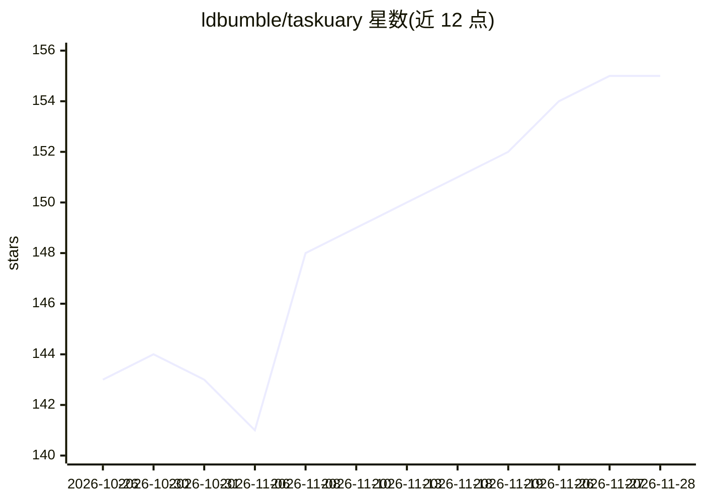

# ldbumble/taskuary

⭐ 155 · Python · MIT · 推送 2026-11-27 · [GitHub](https://github.com/ldbumble/taskuary) · [官网](https://taskuary.com) · 个人维护 · 中文 README

**把邮件/聊天/工单合并成待办列表并由 Agent 代办的本地工具**

Taskuary 将邮件（Gmail、Outlook）、聊天（Slack、Teams、WhatsApp、Telegram）、GitHub、告警与定时报告汇入单一列表，每个条目由 agent 处理：读线程、查询、操作浏览器、产出回复/表格/支付草稿，最终以 Send/Pay/Post 按钮等待用户批准后才会发出。支持 Claude Code、Codex、Gemini、API key 或本地模型作为 AI 后端；内置提示注入缓解机制（分诊无工具、陌生发件人不自动启动 agent、凭据不进入提示）；数据存于本地单文件，可经 WhatsApp/Telegram 远程处理。当前 v0.4.6.13，1.0 前可能存在破坏性变更。

## 筛选速览

| 维度 | 判定 | 备注 |
|---|---|---|
| AI 角色 | `ai-native` | 本体是模型或模型工具 |
| 许可风险 | `permissive` | MIT |
| 部署形态 | `self-host` | docker 或自建部署 |
| 模型依赖 | — | README 未给出锁定关系 |
| 硬件要求 | — | 无带数字的原话,不猜 |
| 安装摩擦 | `low` | 无编译、无系统依赖或容器化 |
| 成熟度 | `idea` | |

## 能力要点

- 邮件/聊天/工单/报告汇入单列表并按需处理分级
- agent 产出成品草稿，发出前需用户按键批准
- 提示注入缓解：分诊模型无工具、不可逆操作等待确认、凭据从提示中移除
- 本地运行，数据存单文件；用本地模型时数据不出本机

## 适用场景

- 用一个界面处理多个邮箱、群聊与工单来源
- 让 agent 起草回复/帖子/支付，人工批准后再发出
- 通过 WhatsApp 或 Telegram 在手机上处理待办列表

## 场景标签

`工作流自动化` `AI 助手` · 领域:效率与自动化

## 证据(README 行号)

> L11: **AI agents that work your inbox. You approve what leaves.**
> L17: Runs on your computer. Free, open source, bring your own AI (Claude Code, Codex, Gemini, an API key, or a local
> L91: Taskuary reads text written by strangers, so it assumes some of it is written to steer the AI. No model reliably

## 星数曲线

2026-10-26 143 → 2026-11-28 155（+12）

---
*卡片 v1 · prompt 1.4 · 生成 2026-11-28 · 置信度 high · 依据 README sha `ac62b4ff1524` · [字段定义](../../DATASET.md)*
