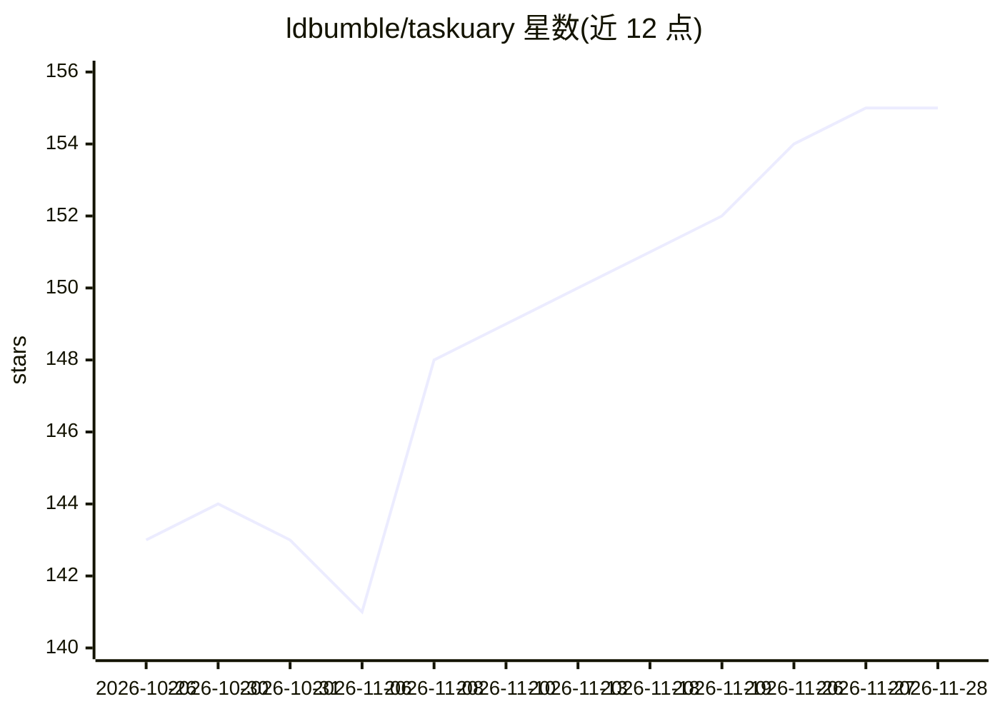

# ldbumble/taskuary

⭐ 155 · Python · MIT · 推送 2026-11-27 · [GitHub](https://github.com/ldbumble/taskuary) · [官网](https://taskuary.com) · 个人维护 · 中文 README

**把邮件、聊天、工单汇成一个列表，由 agent 处理、用户按键批准后发出**

Taskuary 将 Gmail/Outlook 邮件、Slack/Teams/WhatsApp/Telegram 聊天、GitHub 与定时报告汇入同一工作列表，由 agent 逐项研究、起草回复、生成表格或填写表单，所有外发动作需用户按下 Send/Pay/Post 才执行。自带提示注入防护：分诊阶段模型无工具、陌生发件人不自动触发 agent、凭据在送入托管模型前被移除。数据存于本机单文件，可搭配本地模型使用。v0.4.6.4 为早期版本，1.0 前可能存在破坏性变更。

## 筛选速览

| 维度 | 判定 | 备注 |
|---|---|---|
| AI 角色 | `ai-native` | 本体是模型或模型工具 |
| 许可风险 | `permissive` | MIT |
| 部署形态 | `self-host` | docker 或自建部署 |
| 模型依赖 | — | README 未给出锁定关系 |
| 硬件要求 | — | 无带数字的原话,不猜 |
| 安装摩擦 | `low` | 无编译、无系统依赖或容器化 |
| 成熟度 | `idea` | |

## 能力要点

- 邮件/聊天/工单/报告汇入一个排序列表
- agent 执行实际工作（浏览器操作、填表、生成文件），非仅摘要
- 每条外发动作等待用户一键批准，批准时再次检查
- LEARNED.md 记录从用户修改草稿中学到的偏好

## 适用场景

- 让 agent 起草邮件和帖子回复，确认后一键发出
- 用手机通过 WhatsApp/Telegram 处理工作列表
- 整合多个收件渠道，减少逐一查看多个应用

## 场景标签

`AI 助手` `浏览器自动化` · 领域:效率与自动化

## 证据(README 行号)

> L13: Taskuary pulls mail, chats, tickets and reports into one list. An agent works each item - researches, drafts the
> L71: Every email, post, push and payment waits as a card. Edit it, send it, or say no. Nothing leaves until you press.
> L110: Your data stays in one file on your computer. Only what a task needs goes to the AI you chose; with a local model,

## 星数曲线

2026-10-26 143 → 2026-11-28 155（+12）

---
*卡片 v1 · prompt 1.4 · 生成 2026-11-27 · 置信度 high · 依据 README sha `e164b5f22815` · [字段定义](../../DATASET.md)*
