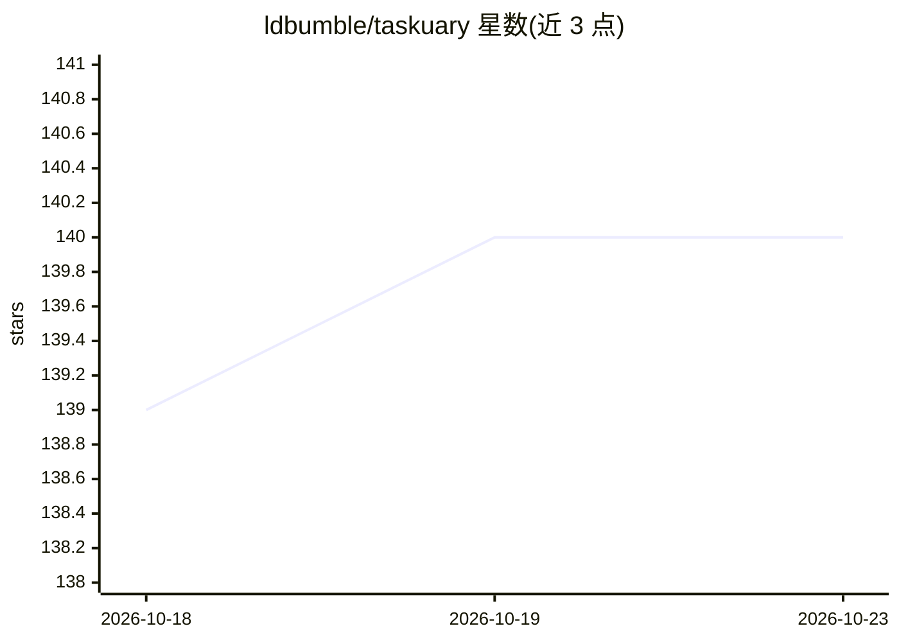

# ldbumble/taskuary

⭐ 140 · Python · MIT · 推送 2026-10-22 · [GitHub](https://github.com/ldbumble/taskuary) · [官网](https://taskuary.com) · 个人维护 · 中文 README

**本地运行的个人信息AI助手：邮件/工单转任务，AI CLI 代办**

本地运行的个人工作助理：将邮件、聊天、工单、告警等汇入统一任务轨道并分类（紧急/待办/目标等），可调用用户已有的编码 CLI（Claude Code、Codex、Gemini、Qwen Code、Kimi Code 等）执行任务，产出回复草稿，经用户批准后才发出。含 Hub 共享知识、agent 交接看板、LEARNED.md 偏好记忆与 outcome ledger。凭据在提示词出站前被规则化脱敏；当前 v0.3.9.16，1.0 前可能出现破坏性变更。

## 筛选速览

| 维度 | 判定 | 备注 |
|---|---|---|
| AI 角色 | `ai-native` | 本体是模型或模型工具 |
| 许可风险 | `permissive` | MIT |
| 部署形态 | `desktop` | 安装包/桌面程序 |
| 模型依赖 | local-ok | 支持本地模型 |
| 硬件要求 | — | 无带数字的原话,不猜 |
| 安装摩擦 | `low` | 无编译、无系统依赖或容器化 |
| 成熟度 | `idea` | |

## 能力要点

- 多渠道入站统一分拣为任务轨道并做分诊
- 接入 Claude Code / Codex / Gemini 等编码 CLI 执行任务，回复需人工批准
- LEARNED.md 证据驱动偏好学习，可读改删、可关闭
- 提示词出站前确定性凭据脱敏（如 [redacted:aws-key]）

## 适用场景

- 把邮件、聊天、工单集中到一个本地工作台统一处理
- 让现有编码 CLI agent 处理日常任务并审批其回复草稿
- 在数据不出本机的前提下运行个人 AI 工作助理

## 场景标签

`AI 助手` `编码 Agent` · 领域:编码与开发

## 证据(README 行号)

> L16: **A personal AI assistant for your job.** Mail, chats and tickets become tasks, the agents you already use (Claude 
> L65: **Send to agent** and it works in the same card. Here the analyst prepares the numbers, checks
> L75: The drafted reply to Ruth waiting on its task, with Approve & send, Mark done, and Regenerate with AI.

## 星数曲线

2026-10-18 139 → 2026-10-23 140（+1）

---
*卡片 v1 · prompt 1.4 · 生成 2026-10-22 · 置信度 high · 依据 README sha `b78f39af4eaf` · [字段定义](../../DATASET.md)*
