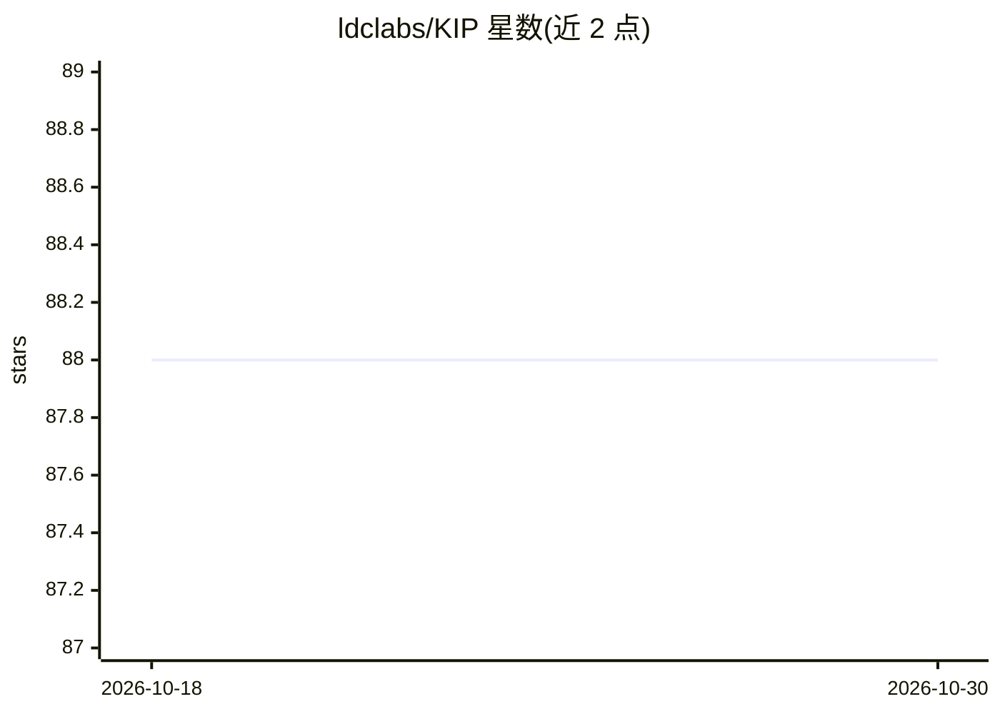

# ldclabs/KIP

⭐ 88 · HTML · MIT · 推送 2026-10-26 · [GitHub](https://github.com/ldclabs/KIP) · [官网](https://anda.ai) · 组织维护 · 中文 README

**面向 AI agent 开发者的持久记忆与学习开放协议**

KIP 2.0（规范草案）为 agent 开发者定义持久记忆与学习的认知状态协议：以真值中立的 Proposition 与带立场的 Assertion 区分陈述与信念，读取时计算信念投影，三种变更各留独立历史；提供 Watch 主动注意、结果证据通道、技能生命周期与签名 Cognitive Capsule 导出。仓库含规范、TypeScript 工具链与 VS Code 扩展；不含生产引擎，自声明无学习结果，v1 已冻结。

## 筛选速览

| 维度 | 判定 | 备注 |
|---|---|---|
| AI 角色 | `ai-ecosystem` | LLM/agent 周边工具 |
| 许可风险 | `permissive` | MIT |
| 部署形态 | `library` | 以包/库形式分发 |
| 模型依赖 | — | README 未给出锁定关系 |
| 硬件要求 | — | 无带数字的原话,不猜 |
| 安装摩擦 | `low` | 无编译、无系统依赖或容器化 |
| 成熟度 | `idea` | |

## 能力要点

- 区分 Meaning/Belief/Authority：Proposition 真值中立，信念为读取时计算的 Epistemic Projection
- 主动层四机制：Watch（含 silence watch）、action_gate、LIST DEPENDENTS、PURGE PAYLOAD
- 技能生命周期 proposed→trialed→adopted→revoked，晋升需不可变 EvaluationRecord 佐证
- 认知状态以签名 Cognitive Capsule 导出，导入由目标端治理

## 适用场景

- 为自研 agent 接入可审计、可跨引擎迁移的持久记忆层
- 让 agent 依据真实结果反馈修订信念与技能
- 多个 Brain 共享同一认知状态并互相审计决策

## 场景标签

`Agent 记忆` · 领域:Agent 开发

## 证据(README 行号)

> L1: # KIP 2.0 — Cognitive State Protocol for Agent Memory
> L105: This repository defines the protocol and its tooling; it does not contain a production engine or Brain. Each imple

## 星数曲线

2026-10-18 88 → 2026-10-30 88（+0）

---
*卡片 v1 · prompt 1.4 · 生成 2026-10-23 · 置信度 high · 依据 README sha `822a0cf65382` · [字段定义](../../DATASET.md)*
