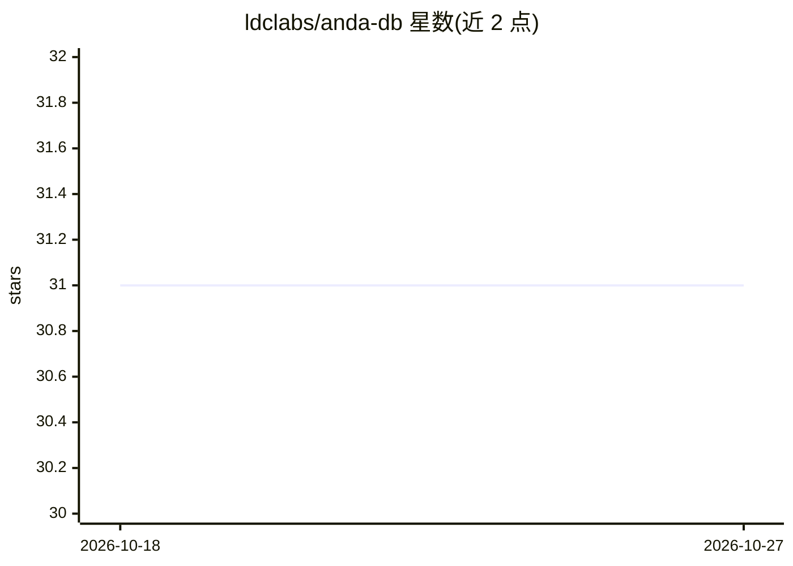

# ldclabs/anda-db

⭐ — · [GitHub]() · 组织维护 · 中文 README

**面向 AI Agent 记忆的 Rust 嵌入式数据库与 KIP 协议引擎**

模块化 Rust 工作区，核心为嵌入式、schema 感知的文档数据库，内置 B-Tree 精确/范围过滤、BM25 全文检索与 HNSW 向量相似度三种检索模式，通过倒数排序融合实现混合检索。持久化基于 object_store 抽象，支持本地文件系统与 S3/GCS/Azure Blob，含增量刷写、检查点、崩溃恢复与可选 AES-256-GCM 静态加密。工作区另含 KIP 2.0 认知状态协议 SDK（parser/AST/envelope）与两个参考引擎（Rust Cognitive Nexus 和运行于 Cloudflare Durable Objects 的 TypeScript 引擎），并提供 HTTP 服务、分片代理、Python 绑定等部署形态。限制：需 Rust 1.95+，0.13→0.14 为破坏性升级。

## 筛选速览

| 维度 | 判定 | 备注 |
|---|---|---|
| AI 角色 | `ai-ecosystem` | LLM/agent 周边工具 |
| 许可风险 | `permissive` | — |
| 部署形态 | `library` | 以包/库形式分发 |
| 模型依赖 | — | README 未给出锁定关系 |
| 硬件要求 | — | 无带数字的原话,不猜 |
| 安装摩擦 | `low` | 无编译、无系统依赖或容器化 |
| 成熟度 | — | 结构信号不足 |

## 能力要点

- B-Tree + BM25 + HNSW 三索引混合检索（倒数排序融合）
- 基于 object_store 的可移植持久化：本地/内存/S3/GCS/Azure Blob
- KIP 2.0 协议 SDK 与两个参考 KIP 引擎（Rust / TypeScript on Durable Objects）
- 可选 AES-256-GCM 静态加密、崩溃恢复与分片代理部署

## 适用场景

- 为 AI Agent 提供长期记忆存储（事实、事件、偏好与嵌入向量）
- 在 Rust 服务内嵌入结构化+词法+语义混合检索
- 通过 KIP 与 Cognitive Nexus 构建知识图谱式记忆（记录谁在何证据下主张什么）
- 私有或合规部署：数据留在自有环境，可加静态加密

## 场景标签

`Agent 记忆` `向量数据库` `知识图谱` · 领域:Agent 开发

## 证据(README 行号)

> L8: Anda DB is a modular Rust workspace for building durable AI memory systems.
> L53: - long-term memory for AI agents
> L66: - **Agent long-term memory**: persist facts, observations, preferences,

## 星数曲线

2026-10-18 31 → 2026-10-27 31（+0）

---
*卡片 v1 · prompt 1.4 · 生成 2026-10-26 · 置信度 high · 依据 README sha `e55051bf8a37` · [字段定义](../../DATASET.md)*
