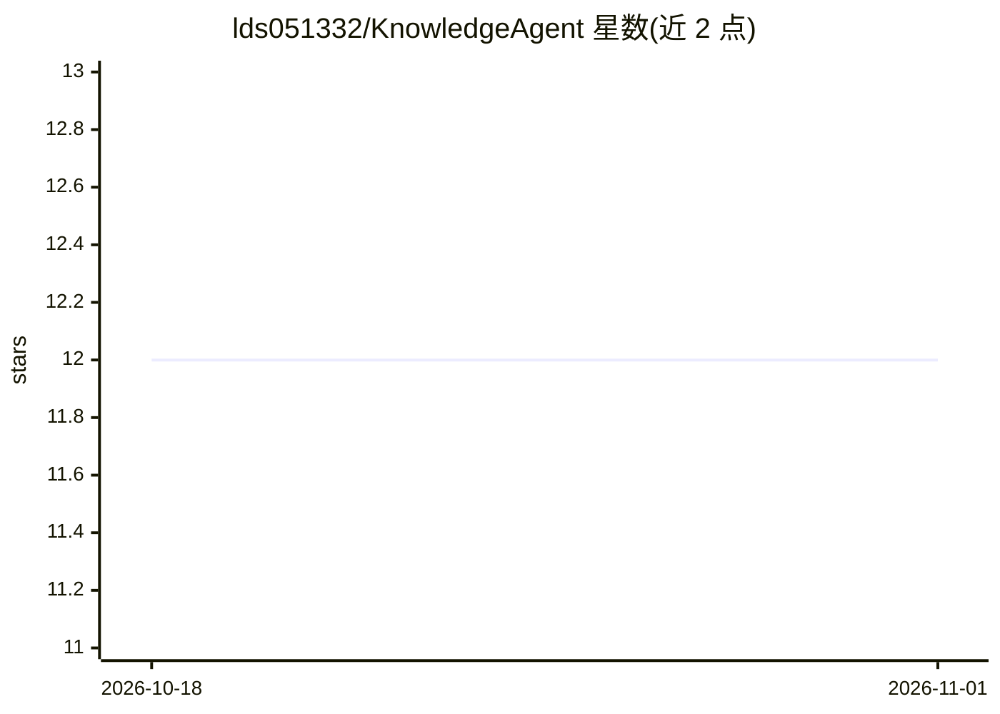

# lds051332/KnowledgeAgent

⭐ 12 · Python · MIT · 推送 2026-08-27 · [GitHub](https://github.com/lds051332/KnowledgeAgent) · 个人维护 · 中文 README

**自托管 Agentic RAG 知识库：从自有文档获得带引用的问答**

单用户自托管的私有知识库与问答应用：导入 Markdown/PDF/DOCX 构建知识树，混合检索（FTS5/BM25、受限 grep、可选向量）经 RRF 融合，agent 调用六种工具且仅基于检索片段作答，答案附可点击的来源（文档、路径、标题、页码）。支持任意 OpenAI 兼容端点（含本地 Ollama），无模型时可设 heuristic 离线模式。前端 Vue 3、后端 FastAPI，Docker Compose 部署，数据留在本机；v1 不含多租户/SSO 等企业功能。

## 筛选速览

| 维度 | 判定 | 备注 |
|---|---|---|
| AI 角色 | `ai-native` | 本体是模型或模型工具 |
| 许可风险 | `permissive` | MIT |
| 部署形态 | `self-host` | docker 或自建部署 |
| 模型依赖 | local-ok | 支持本地模型 |
| 硬件要求 | — | 无带数字的原话,不猜 |
| 安装摩擦 | `low` | 无编译、无系统依赖或容器化 |
| 成熟度 | — | 结构信号不足 |

## 能力要点

- Markdown/PDF/DOCX 导入，失败可从不可变原件重试
- FTS5/BM25 + grep + 可选向量的混合检索，RRF 融合
- agent 六种工具，回答仅基于检索片段并附来源引用
- 兼容任意 OpenAI 兼容端点（含 Ollama），可选无云端 heuristic 模式

## 适用场景

- 把个人或团队的文档建成私有可检索知识库
- 无云端 key 时用本地 Ollama 或离线模式运行问答
- 查错误码等场景用 grep 式精确检索定位片段

## 场景标签

`文档问答` `知识库管理` · 领域:知识与检索

## 证据(README 行号)

> L3: Lightweight, self-hosted **Agentic RAG**. Import Markdown, PDF, and DOCX; organize a private knowledge tree; search 
> L14: - **Agent tools** — `vector_search`, `keyword_search`, `grep_search`, `read_document`, `read_section`, `list_folder
> L16: - **Your LLM** — Any OpenAI-compatible Chat Completions endpoint, including Ollama at `http://localhost:11434/v1`. 

## 星数曲线

2026-10-18 12 → 2026-11-01 12（+0）

---
*卡片 v1 · prompt 1.4 · 生成 2026-11-01 · 置信度 high · 依据 README sha `ecf1af815258` · [字段定义](../../DATASET.md)*
