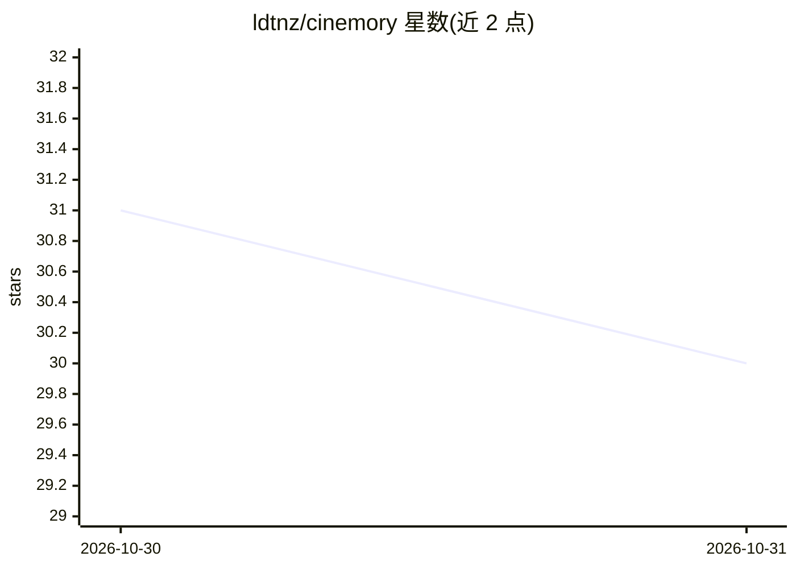

# ldtnz/cinemory

⭐ 30 · TypeScript · AGPL-3.0 · 推送 2026-10-20 · [GitHub](https://github.com/ldtnz/cinemory) · 个人维护

**个人观影目录 PWA：导入流媒体观看历史并追踪管理**

自托管的单用户观影记录应用：从 Netflix、Prime Video、IMDb、Letterboxd 或 Disney+ 导出文件导入观看历史，TMDB 补全海报、评分、类型与年份；支持过滤检索、剧集季数追踪、统计、待看清单、JSON 备份恢复，通过 TOTP 单用户认证登录。AI 为可选功能：设置 ANTHROPIC_API_KEY 后由 Claude 生成观看建议（每 5 天自动刷新），另有无需 AI key 的本地语义搜索与可选 MCP 端点。部署支持 Vercel+Turso 或 Docker 自建。

## 筛选速览

| 维度 | 判定 | 备注 |
|---|---|---|
| AI 角色 | `ai-enhanced` | 去掉 AI 部分产品仍成立 |
| 许可风险 | `viral` | AGPL-3.0 |
| 部署形态 | `library` | 以包/库形式分发 |
| 模型依赖 | — | README 未给出锁定关系 |
| 硬件要求 | — | 无带数字的原话,不猜 |
| 安装摩擦 | `low` | 无编译、无系统依赖或容器化 |
| 成熟度 | — | 结构信号不足 |

## 能力要点

- 5 种服务观看历史导入，去重合并
- TMDB 补全海报、评分、类型、季数等元数据
- 可选 Claude 推荐与本地语义搜索（后者无需 AI key）
- 可选 MCP 端点让 AI 助手读取目录；PWA 离线可打开

## 适用场景

- 把散落在各流媒体平台的观看记录汇成一个目录
- 记录追剧进度并查看观影统计
- 让 Claude 基于自己的目录推荐下一部要看的内容

## 场景标签

`语义搜索` · 领域:知识与检索

## 证据(README 行号)

> L11: A personal catalog for everything you have watched on Netflix, Prime Video,
> L71: - **AI recommendations** *(optional)* — Claude suggests titles to watch next
> L15: Optionally, Claude looks at your catalog

## 星数曲线

2026-10-30 31 → 2026-10-31 30（-1）

---
*卡片 v1 · prompt 1.4 · 生成 2026-10-30 · 置信度 mid · 依据 README sha `924667b1c3ba` · [字段定义](../../DATASET.md)*
