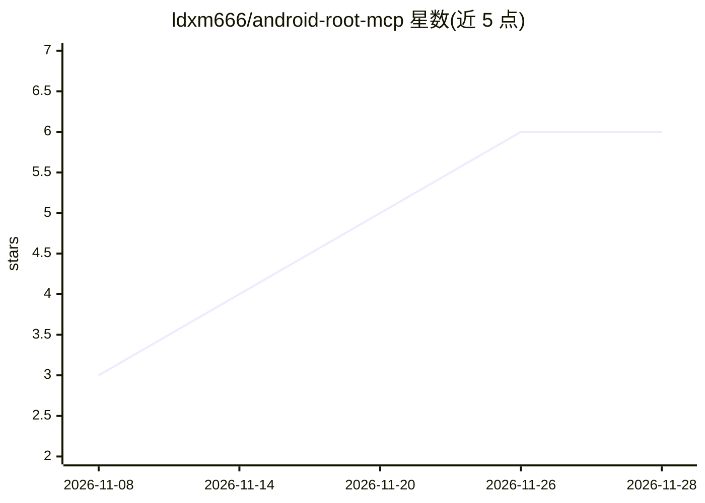

# ldxm666/android-root-mcp

⭐ 6 · Python · MIT · 推送 2026-11-05 · [GitHub](https://github.com/ldxm666/android-root-mcp) · 个人维护 · 中文 README

**供 AI agent 通过 MCP 驱动已 root 安卓手机的语义控制服务器**

一个 MCP server，让 AI agent 以系统报告的控件语义驱动已 root 的 Android 设备：感知层将 uiautomator 层级 dump 转为带 role/label/semantic_key 的可寻址控件；动作层由常驻 root 守护进程直接写 input_event，降低点击/滑动手势延迟；对 OS 未命名的控件提供 probe-and-remember 探测学习，并拒绝删除/支付/卸载等危险目标。不含 OCR 与视觉，未标注控件保持未标注。要求设备已 root（KernelSU/Magisk）、PATH 有 adb、Python 3.10+。

## 筛选速览

| 维度 | 判定 | 备注 |
|---|---|---|
| AI 角色 | `ai-ecosystem` | LLM/agent 周边工具 |
| 许可风险 | `permissive` | MIT |
| 部署形态 | `library` | 以包/库形式分发 |
| 模型依赖 | — | README 未给出锁定关系 |
| 硬件要求 | — | 无带数字的原话,不猜 |
| 安装摩擦 | `low` | 无编译、无系统依赖或容器化 |
| 成熟度 | — | 结构信号不足 |

## 能力要点

- OS 报告语义感知：role/label/semantic_key 无坐标寻址，未标注控件输出 label 空串
- 常驻 root 输入守护进程写 /dev/input 事件，回退链含 injectInputEvent/uiautomator2/adb input
- probe-and-remember 学习：点击探测未命名控件并持久化观测效果，拒绝危险目标并记录
- act 一次往返同时返回操作结果与屏幕变化分类（navigation/dialog/scrolled 等）

## 适用场景

- 让 AI agent 自动操作微信等不设 clickable 标志的安卓应用
- 为安卓自动化 agent 提供比截图+坐标点击更可靠的控件寻址
- 对 OS 无标签的控件做一次探测并记住其效果以备后续调用

## 场景标签

`GUI 自动化` · 领域:效率与自动化

## 证据(README 行号)

> L3: **An MCP server that drives a rooted Android phone the way a person does: it reads what the operating system reports
> L15:     A[AI agent] -->|MCP tool call| B[android-root-mcp]
> L111: - A **rooted** device — KernelSU or Magisk. Root is a design requirement, not a convenience.

## 星数曲线

2026-11-08 3 → 2026-11-28 6（+3）

---
*卡片 v1 · prompt 1.4 · 生成 2026-11-21 · 置信度 high · 依据 README sha `4aadd3bf9d13` · [字段定义](../../DATASET.md)*
