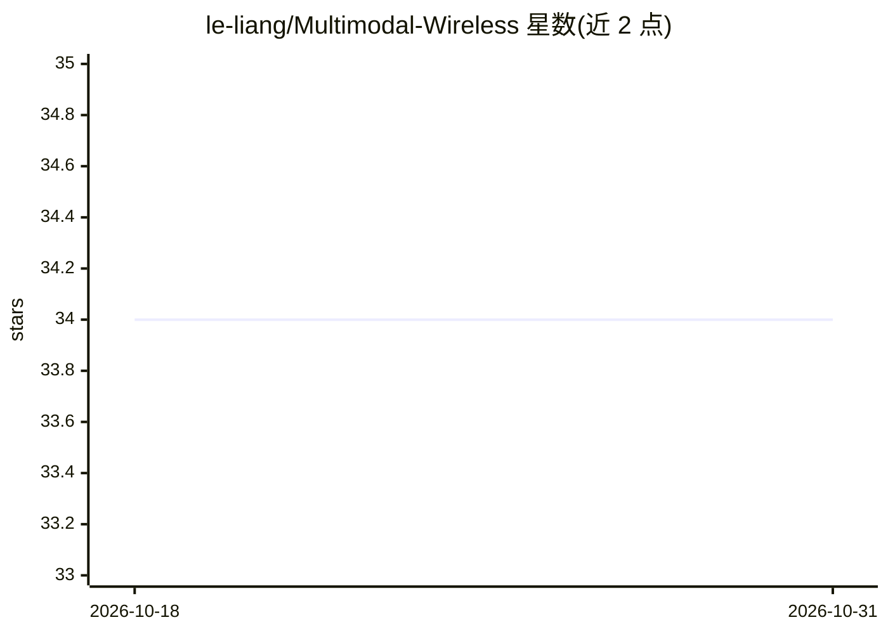

# le-liang/Multimodal-Wireless

⭐ 34 · Python · MIT · 推送 2026-10-29 · [GitHub](https://github.com/le-liang/Multimodal-Wireless) · [官网](https://le-liang.github.io/mmw/) · 个人维护 · 中文 README

**多模态无线通信数据集的扩展与重放工具包**

Multimodal-Wireless 数据集配套的 Python 脚本与资产工具包，支持对该数据集进行扩展生成或重放既有场景。生成管线基于三步流程：在 CARLA 中定义并产出多传感器数据，在 Blender 中重建首帧场景，再在 Sionna RT 中逐帧更新车辆位姿并计算多径信道。v1.1.0 通过复用静态场景与逐帧更新替代逐帧完整场景导入，降低生成时间与存储开销。运行需自备 Blender 4.3.2、Mitsuba 插件与 CARLA 0.9.15。

## 筛选速览

| 维度 | 判定 | 备注 |
|---|---|---|
| AI 角色 | `ai-knowledge` | 知识聚合/清单类 |
| 许可风险 | `permissive` | MIT |
| 部署形态 | `desktop` | 安装包/桌面程序 |
| 模型依赖 | — | README 未给出锁定关系 |
| 硬件要求 | — | 无带数字的原话,不猜 |
| 安装摩擦 | `low` | 无编译、无系统依赖或容器化 |
| 成熟度 | — | 结构信号不足 |

## 能力要点

- CARLA→Blender→Sionna 三步数据生成管线
- v1.1.0 逐帧更新车辆位姿替代逐帧完整场景导入
- 支持 LOS 反射信道与纯 NLOS 散射信道两种采集脚本
- 提供数据集中国大陆镜像下载

## 适用场景

- 重放数据集中的既有无线通信场景
- 基于管线扩展生成新的多模态场景数据
- 研究通感一体化（ISAC）多模态数据生成方法

## 场景标签

 · 领域:无线通信/感知数据集

## 证据(README 行号)

> L3: This guide provides instructions on how to set up the environment and software needed to extend or replay the Multim
> L88: - CARLA: Define the scenario in CARLA via the config file and implement it via carla_main.py, which produces five s

## 星数曲线

2026-10-18 34 → 2026-10-31 34（+0）

---
*卡片 v1 · prompt 1.4 · 生成 2026-10-25 · 置信度 high · 依据 README sha `f5b0ffe7c1ba` · [字段定义](../../DATASET.md)*
