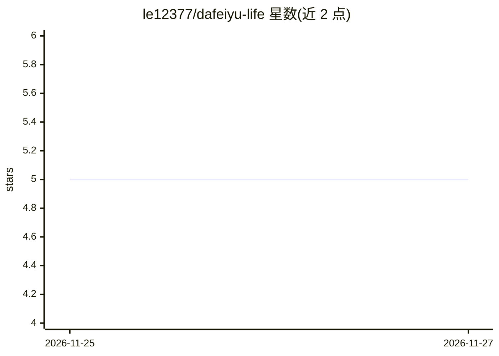

# le12377/dafeiyu-life

⭐ 5 · Python · 推送 2026-11-11 · [GitHub](https://github.com/le12377/dafeiyu-life) · 个人维护 · 中文 README

**个人 QQ AI 陪伴机器人的完整配置档案与安装记录**

一份仍在运行的 AstrBot 实例的脱敏配置档案：以 DeepSeek 为大脑、NapCat/OneBot v11 接入 QQ，配本地声音克隆（Breeze-TTS-2）、本地生图（ComfyUI + MOSS-Image）、LivingMemory 长期记忆（Ollama + bge-m3 算向量、写 FAISS）以及经 MCP 接入的 Obsidian 知识库。仓库提供可照抄的脱敏配置、按教程十章组织的安装踩坑文档、5 个自写补丁插件和十二天运行统计；聊天原文与数据库未公开。硬件需 Windows 10 x64，生图需 8GB 显存。

## 筛选速览

| 维度 | 判定 | 备注 |
|---|---|---|
| AI 角色 | `ai-native` | 本体是模型或模型工具 |
| 许可风险 | `none` | — |
| 部署形态 | `None` |  |
| 模型依赖 | local-ok | 支持本地模型 |
| 硬件要求 | `gpu-8g` | |
| 安装摩擦 | `low` | 无编译、无系统依赖或容器化 |
| 成熟度 | — | 结构信号不足 |

## 能力要点

- AstrBot + NapCat 接入 QQ，DeepSeek 作为对话模型
- 本地声音克隆（Breeze-TTS-2）与本地生图（ComfyUI + MOSS-Image）
- LivingMemory 记忆链路：向量 + BM25/FTS5 检索，RRF 融合注入
- 5 个修复具体故障的自写插件源码与脱敏导出/扫描脚本

## 适用场景

- 照着文档在 Windows 上从零搭一个 QQ 陪伴机器人
- 把云端 TTS 换成本地声音克隆，避免按条计费
- 给机器人接长期记忆和 Obsidian 知识库
- 参考踩坑记录排查 NapCat 断线、语音时长异常等问题

## 场景标签

`聊天机器人` `图像生成` `语音合成` `教程课程` · 领域:对话与助手

## 证据(README 行号)

> L19: 这是一台还在运行的 AstrBot 实例的完整配置档案。大脑是 DeepSeek，通过 NapCat 接进 QQ；嗓子是本机克隆出来的声音，手是本机的 ComfyUI，记性是 LivingMemory 加本地向量模型，另外接了一个
> L292: ① AstrBot → ② NapCat → ③ 接上模型      到这一步，能在 QQ 里聊天

## 星数曲线

2026-11-25 5 → 2026-11-27 5（+0）

---
*卡片 v1 · prompt 1.4 · 生成 2026-11-24 · 置信度 high · 依据 README sha `5b8957fe9a0a` · [字段定义](../../DATASET.md)*
