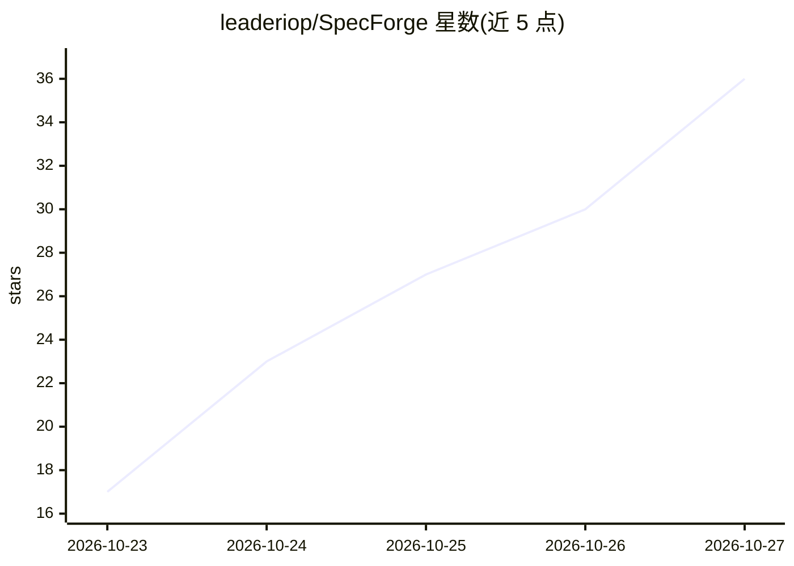

# leaderiop/SpecForge

⭐ 36 · Rust · Apache-2.0 · 推送 2026-10-26 · [GitHub](https://github.com/leaderiop/SpecForge) · 组织维护

**把团队规则编译成确定性检查的规范工具，供 AI agent 使用**

Rust 编写的单二进制规范检查工具：把系统需求写成结构化 .spec 文件（behavior/invariant/event 等），像编译器一样检查引用、规则是否被 enforce、承诺是否被测试证明，检查过程无 AI 参与、同输入同结论。通过 MCP 协议接入 Claude Code、Cursor 等 agent，agent 起草规范、SpecForge 校验并反馈错误，测试通过 specforge collect 记录每条承诺的证明情况。领域词汇由扩展提供（software/product/governance/formal 等），formal 扩展需 z3 求解器，其余无依赖。

## 筛选速览

| 维度 | 判定 | 备注 |
|---|---|---|
| AI 角色 | `ai-ecosystem` | LLM/agent 周边工具 |
| 许可风险 | `permissive` | Apache-2.0 |
| 部署形态 | `desktop` | 安装包/桌面程序 |
| 模型依赖 | — | README 未给出锁定关系 |
| 硬件要求 | — | 无带数字的原话,不猜 |
| 安装摩擦 | `low` | 无编译、无系统依赖或容器化 |
| 成熟度 | — | 结构信号不足 |

## 能力要点

- 确定性检查：无 AI 参与，同输入同结论
- MCP 原生接入，可配合 Claude Code、Cursor 等 MCP 客户端
- 扩展机制内置 software/product/governance/formal 等领域词汇包
- 测试与规范条目关联，specforge collect 记录已证明/未证明的承诺

## 适用场景

- 让 AI agent 起草规范并由工具强制校验，避免规则被静默忽略
- 在 CI 中用 specforge check --strict 阻止不一致的规范合入
- 追踪哪些需求有测试证明、哪些仍未覆盖

## 场景标签

 · 领域:软件开发/规格管理工具

## 证据(README 行号)

> L62: **SpecForge is a tool for hard skills.** You (or more often, your agent) write down what must be true in small, str
> L72: 3. **SpecForge checks the draft.** Typos, rules nobody enforces, missing pieces: the check fails with the exact lin

## 星数曲线

2026-10-23 17 → 2026-10-27 36（+19）

---
*卡片 v1 · prompt 1.4 · 生成 2026-10-26 · 置信度 high · 依据 README sha `c297cb185fe4` · [字段定义](../../DATASET.md)*
