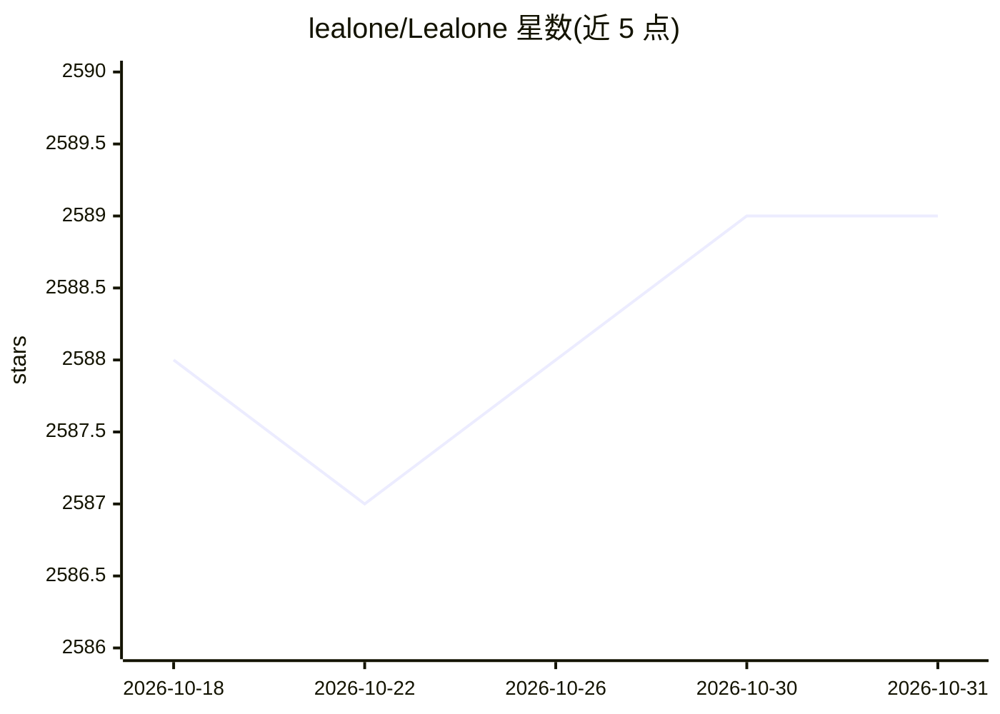

# lealone/Lealone

⭐ 2,589 · Java · NOASSERTION · 推送 2026-10-29 · [GitHub](https://github.com/lealone/Lealone) · 组织维护 · 中文 README

**带 AI Agent 的全栈数据库：自然语言生成并运行应用**

Lealone 是一个 NewSQL 数据库项目，8.0 版本加入自进化通用智能体能力：通过 `-agent` 命令启动 agent 窗口，用 SQL 语句配置大模型（当前支持豆包与 DeepSeek），输入自然语言（如“实现一个 todo 应用”）后生成并运行应用返回访问 URL；也支持零代码或从需求文档 SQL 文件直接创建并执行企业级服务。构建运行需要 JDK 21+，可用 Maven 编译或直接下载 jar。README 较简短，机制细节有限。

## 筛选速览

| 维度 | 判定 | 备注 |
|---|---|---|
| AI 角色 | `ai-native` | 本体是模型或模型工具 |
| 许可风险 | `none` | NOASSERTION |
| 部署形态 | `None` |  |
| 模型依赖 | locked-api |  |
| 硬件要求 | — | 无带数字的原话,不猜 |
| 安装摩擦 | `medium` | 含编译或系统依赖之一 |
| 成熟度 | — | 结构信号不足 |

## 能力要点

- 自然语言生成 todo 应用并返回可访问 URL
- SQL 语句配置大模型（支持豆包、DeepSeek）
- create service 零代码创建并执行服务，支持从 SQL 需求文档直接运行

## 适用场景

- 用自然语言快速生成并运行 todo 等小应用
- 零代码渐进式开发企业级 AI 应用
- 通过需求文档 SQL 文件直接部署服务

## 场景标签

`代码生成` · 领域:编码与开发

## 证据(README 行号)

> L3: * 是一个高性能的全栈自进化通用智能体
> L23: `java -jar lealone-8.0.0-SNAPSHOT.jar -agent`
> L39: 在 agent 窗口输入：实现一个 todo 应用;

## 星数曲线

2026-10-18 2,588 → 2026-10-31 2,589（+1）

---
*卡片 v1 · prompt 1.4 · 生成 2026-10-21 · 置信度 high · 依据 README sha `e2ac18756684` · [字段定义](../../DATASET.md)*
