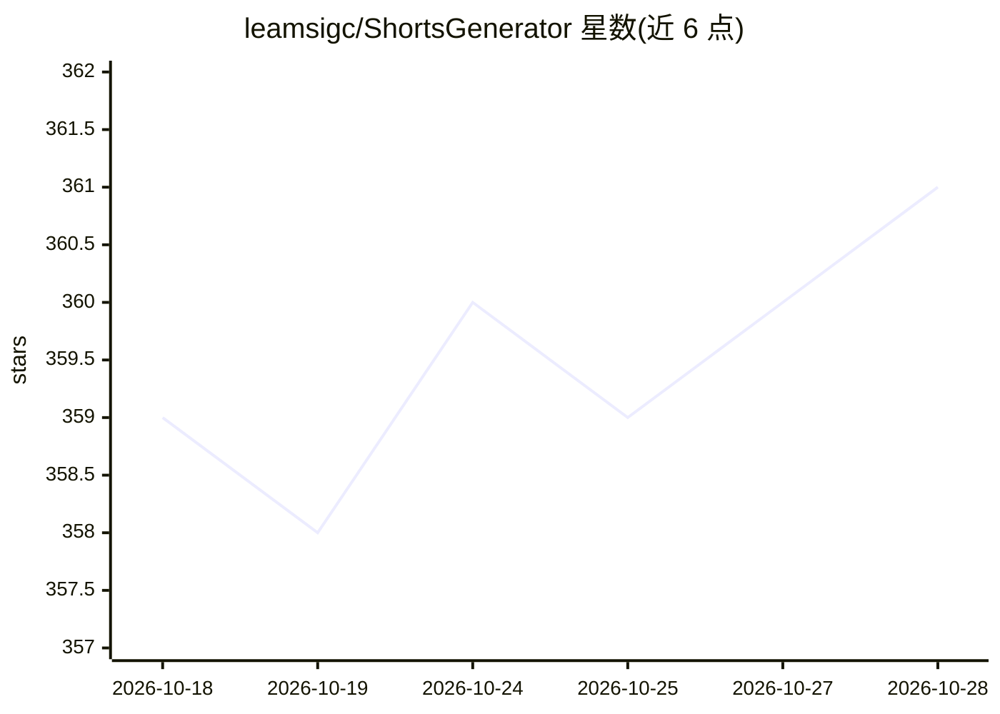

# leamsigc/ShortsGenerator

⭐ 361 · Vue · MIT · 推送 2026-10-11 · [GitHub](https://github.com/leamsigc/ShortsGenerator) · 个人维护

**本地自动化生成 YouTube Shorts 视频的自托管工具**

自托管的短视频生成流水线：用 g4f（免费）或 Gemini 生成脚本，从 Pexels 搜索并下载素材视频，经 Supertonic/TikTok/KittenTTS/Qwen3-TTS 合成配音，叠加 10 种字幕模板、背景音乐与开头图片拼接，支持 9:16 等五种画幅，并通过 MagicSync 定时发布到 Instagram、TikTok、Facebook、LinkedIn、YouTube。后端为 Flask（限定 Python 3.11），前端为 Nuxt 3，提供 Docker compose 与手动安装两种方式。限制：依赖 Pexels API key 与 ImageMagick；Qwen3-TTS 可选且首次预览需下载约 3GB 权重；免费 g4f 路径依赖浏览器登录 cookies。

## 筛选速览

| 维度 | 判定 | 备注 |
|---|---|---|
| AI 角色 | `ai-native` | 本体是模型或模型工具 |
| 许可风险 | `permissive` | MIT |
| 部署形态 | `self-host` | docker 或自建部署 |
| 模型依赖 | — | README 未给出锁定关系 |
| 硬件要求 | — | 无带数字的原话,不猜 |
| 安装摩擦 | `low` | 无编译、无系统依赖或容器化 |
| 成熟度 | — | 结构信号不足 |

## 能力要点

- g4f（免费）或 Gemini 生成脚本，Pexels 自动检索素材片段
- 多引擎 TTS：Supertonic 本地 10 声 33 语言、Qwen3-TTS 本地（预设音色/Voice Design/Voice Clone）
- 10 种字幕模板、背景音乐混合、开头图片拼接与多种画幅
- 经 MagicSync 定时发布至 Instagram/TikTok/Facebook/LinkedIn/YouTube，支持多业务 API key

## 适用场景

- 我想在本地批量生成带配音和字幕的短视频内容
- 我想把生成的视频定时发布到多个社交平台
- 我想克隆或设计自己的 TTS 音色用于配音

## 场景标签

`视频生成` `语音合成` · 领域:内容生成

## 证据(README 行号)

> L5: Automate YouTube Shorts creation locally — script generation, stock video search, TTS voiceover, subtitles, backgrou
> L9: - **AI Script Generation** — uses g4f (free) or Gemini to generate video scripts

## 星数曲线

2026-10-18 359 → 2026-10-28 361（+2）

---
*卡片 v1 · prompt 1.4 · 生成 2026-10-21 · 置信度 high · 依据 README sha `e92399d71538` · [字段定义](../../DATASET.md)*
