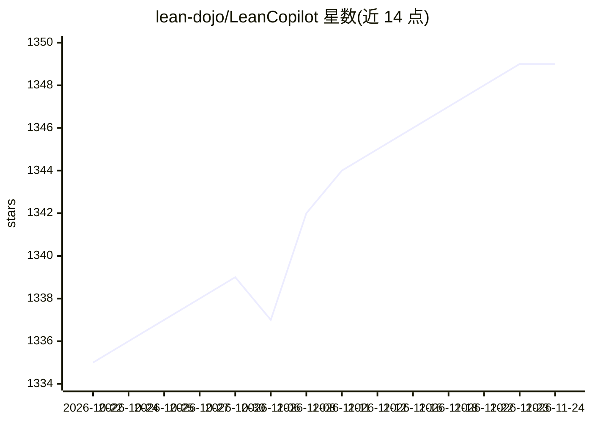

# lean-dojo/LeanCopilot

⭐ 1,349 · C++ · MIT · 推送 2026-11-16 · [GitHub](https://github.com/lean-dojo/LeanCopilot) · [官网](https://leandojo.org/leancopilot.html) · 组织维护

**让 LLM 原生嵌入 Lean 4 的定理证明辅助工具**

以 Lean 4 依赖包形式将 LLM 接入定理证明流程：提供 suggest_tactics（生成策略建议）、search_proof（结合 aesop 搜索多步证明）、select_premises（基于 LeanDojo 检索器选取前提）三个 tactic，并支持在 Lean 中运行任意 LLM 推理（本地经 CTranslate2/FFI 或远程经 ExternalGenerator）。内置四个可从 Hugging Face 下载的 LeanDojo 模型，也允许自带模型。要求 Lean ≥ v4.3.0-rc2，平台以 Linux/macOS 为优先。

## 筛选速览

| 维度 | 判定 | 备注 |
|---|---|---|
| AI 角色 | `ai-native` | 本体是模型或模型工具 |
| 许可风险 | `permissive` | MIT |
| 部署形态 | `self-host` | docker 或自建部署 |
| 模型依赖 | — | README 未给出锁定关系 |
| 硬件要求 | — | 无带数字的原话,不猜 |
| 安装摩擦 | `low` | 无编译、无系统依赖或容器化 |
| 成熟度 | — | 结构信号不足 |

## 能力要点

- suggest_tactics / search_proof / select_premises 三个证明自动化 tactic
- 内置 4 个可下载模型，支持无 GPU 本地运行或云端推理
- Model API 支持 generators 与 encoders，可经 ExternalGenerator 接入任意模型
- select_premises 使用 LeanDojo 检索器从固定 Lean/mathlib4 快照中选取前提

## 适用场景

- 在 Lean 4 证明卡住时生成候选 tactic 并一键插入
- 用 LLM 生成 tactic 结合 aesop 搜索完整证明
- 在 Lean 环境中调用自建或本地 LLM 推理构建自定义自动化

## 场景标签

`编码 Agent` `代码生成` `科研工具` · 领域:编码与开发

## 证据(README 行号)

> L5: Lean Copilot allows large language models (LLMs) to be used natively in Lean for proof automation, e.g., suggesting 
> L75: After `import LeanCopilot`, you can use the tactic `suggest_tactics` to generate tactic suggestions. You can click 
> L97: You can also run the inference of any LLMs in Lean, which can be used to build customized proof automation or other

## 星数曲线

2026-10-22 1,335 → 2026-11-24 1,349（+14）

---
*卡片 v1 · prompt 1.4 · 生成 2026-11-23 · 置信度 high · 依据 README sha `1478b78e195d` · [字段定义](../../DATASET.md)*
