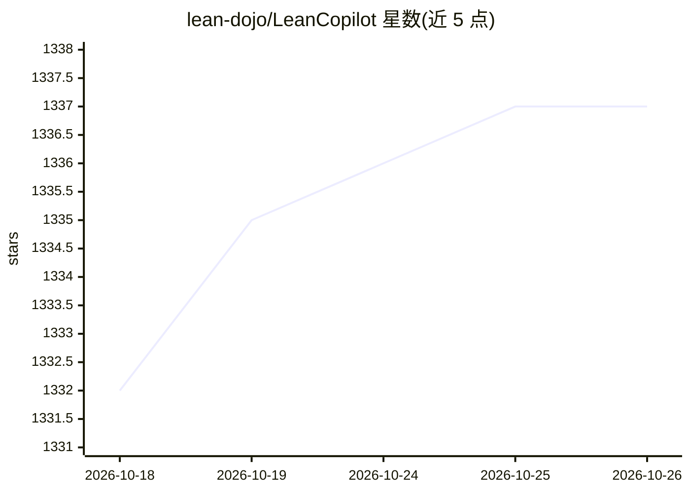

# lean-dojo/LeanCopilot

⭐ 1,337 · C++ · MIT · 推送 2026-10-13 · [GitHub](https://github.com/lean-dojo/LeanCopilot) · [官网](https://leandojo.org/leancopilot.html) · 组织维护

**在 Lean 中原生运行 LLM 做定理证明辅助的库**

面向 Lean 4 形式化数学用户与定理证明研究者的库：提供 suggest_tactics 生成 tactic 建议、search_proof 结合 LLM 与 aesop 搜索多步证明、select_premises 检索前提，内置来自 LeanDojo 的模型（从 Hugging Face 下载），也支持通过 ExternalGenerator/ExternalEncoder 接入本地或云端自定义模型。本地推理基于 CTranslate2 经 FFI 链接，下游项目通常下载预构建版本，无需自行编译；要求 Lean v4.3.0-rc2 以上，Linux/macOS 为优先支持平台。

## 筛选速览

| 维度 | 判定 | 备注 |
|---|---|---|
| AI 角色 | `ai-native` | 本体是模型或模型工具 |
| 许可风险 | `permissive` | MIT |
| 部署形态 | `self-host` | docker 或自建部署 |
| 模型依赖 | — | README 未给出锁定关系 |
| 硬件要求 | — | 无带数字的原话,不猜 |
| 安装摩擦 | `low` | 无编译、无系统依赖或容器化 |
| 成熟度 | — | 结构信号不足 |

## 能力要点

- suggest_tactics/search_proof/select_premises 三个证明辅助 tactic
- 内置 LeanDojo 模型（tacgen/retriever/byt5-small），从 Hugging Face 自动下载
- 通过 ExternalGenerator/ExternalEncoder 接入任意本地或远程模型
- 本地推理由 CTranslate2 经 FFI 支持，可不依赖 GPU

## 适用场景

- 写 Lean 证明时获取 tactic 建议与自动前提检索
- 让 LLM 搜索并插入完整多步证明
- 在 Lean 中运行自定义 LLM 构建证明自动化或其他应用

## 场景标签

`代码生成` · 领域:编码与开发

## 证据(README 行号)

> L5: Lean Copilot allows large language models (LLMs) to be used natively in Lean for proof automation, e.g., suggesting 
> L75: After `import LeanCopilot`, you can use the tactic `suggest_tactics` to generate tactic suggestions. You can click 

## 星数曲线

2026-10-18 1,332 → 2026-10-26 1,337（+5）

---
*卡片 v1 · prompt 1.4 · 生成 2026-10-21 · 置信度 mid · 依据 README sha `2217f724162c` · [字段定义](../../DATASET.md)*
