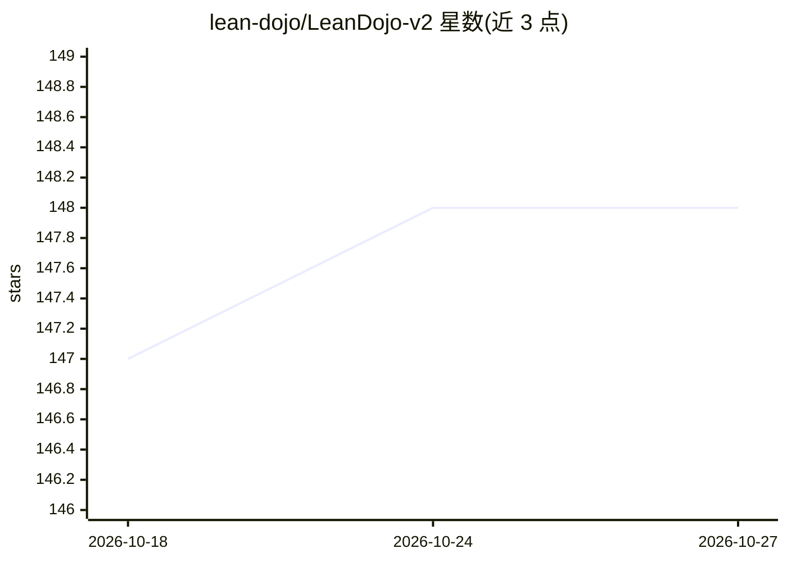

# lean-dojo/LeanDojo-v2

⭐ 148 · Python · Apache-2.0 · 推送 2026-08-10 · [GitHub](https://github.com/lean-dojo/LeanDojo-v2) · [官网](https://leandojo.org/) · 组织维护

**面向 Lean 4 的 AI 定理证明器训练、评估与部署端到端框架**

LeanDojo-v2 是用于训练、评估和部署 Lean 4 AI 辅助定理证明器的端到端框架：从 GitHub 或本地克隆 Lean 仓库并用 ExtractData.lean 插桩追踪，将定理结构化存入动态数据库；提供 SFT、GRPO、检索三类训练器与基于 Pantograph 的 HFProver/RetrievalProver/ExternalProver 三种证明器，支持 LoRA 微调、整证明生成与逐步 tactic 搜索；另有 FastAPI 外部接口供 Lean 编辑器查询 LLM。面向机器学习与定理证明研究者，要求 Python≥3.11、CUDA GPU、elan 工具链与 GitHub token。

## 筛选速览

| 维度 | 判定 | 备注 |
|---|---|---|
| AI 角色 | `ai-ecosystem` | LLM/agent 周边工具 |
| 许可风险 | `permissive` | Apache-2.0 |
| 部署形态 | `library` | 以包/库形式分发 |
| 模型依赖 | — | README 未给出锁定关系 |
| 硬件要求 | — | 无带数字的原话,不猜 |
| 安装摩擦 | `medium` | 含编译或系统依赖之一 |
| 成熟度 | — | 结构信号不足 |

## 能力要点

- SFT/GRPO/检索三类训练器，支持 LoRA 与 DeepSpeed
- Lean 仓库插桩追踪生成 JSONL 数据集并维护动态定理数据库
- 基于 Pantograph 的三种证明器，支持整证明生成与 tactic 搜索
- ExternalAgent 经 Hugging Face Inference API 调用大模型（默认 DeepSeek-Prover-V2-671B），无需本地 GPU

## 适用场景

- 在自选 Lean 4 仓库上微调模型并自动搜索证明
- 无本地 GPU 时通过推理 API 生成完整证明
- 构建检索增强的终身学习定理证明流水线

## 场景标签

`微调` `强化学习` `RAG` · 领域:知识与检索

## 证据(README 行号)

> L3: LeanDojo-v2 is an end-to-end framework for training, evaluating, and deploying AI-assisted theorem provers for Lean 
> L13: 3. Training agent policies with supervised fine-tuning (SFT), GRPO-style RL, or retrieval objectives.
> L21: - **Unified Agent Abstractions**: `BaseAgent` orchestrates repository setup, training, and proving. Concrete implem

## 星数曲线

2026-10-18 147 → 2026-10-27 148（+1）

---
*卡片 v1 · prompt 1.4 · 生成 2026-10-22 · 置信度 high · 依据 README sha `faa6054f706a` · [字段定义](../../DATASET.md)*
