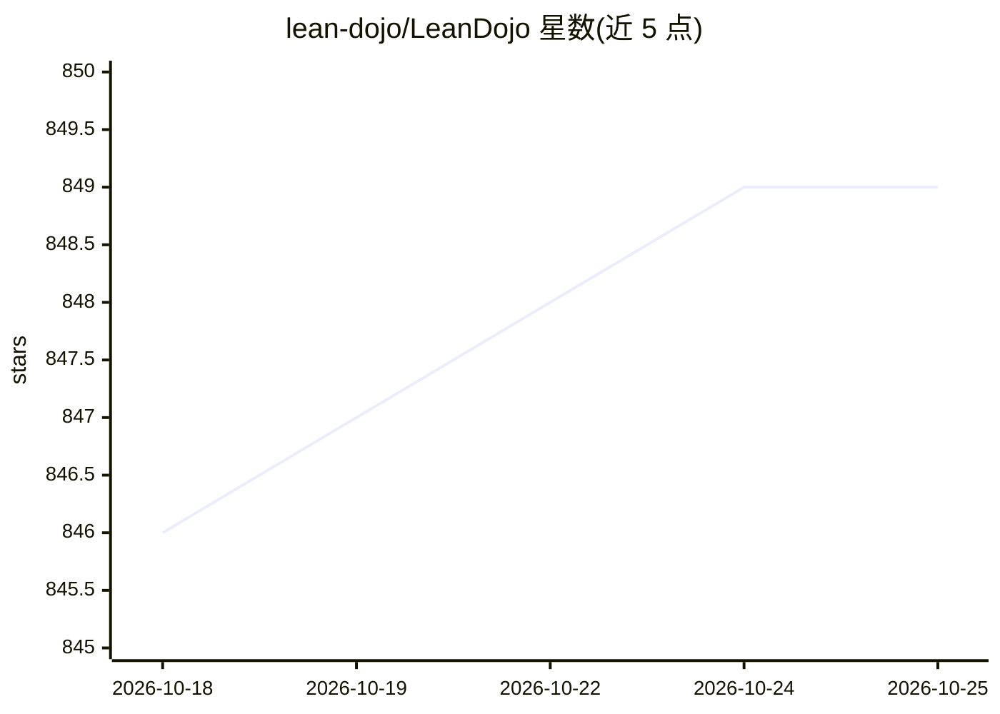

# lean-dojo/LeanDojo

⭐ 849 · Python · MIT · 推送 2026-01-18 · [GitHub](https://github.com/lean-dojo/LeanDojo) · [官网](https://leandojo.org/leandojo.html) · 组织维护

**从 Lean 代码库抽取证明数据并以编程方式交互的 Python 库**

面向基于机器学习的 Lean 定理证明器的 Python 库，提供两项主要功能：从 Lean 仓库抽取证明状态、策略、前提等数据，以及以编程方式与 Lean 交互。当前版本兼容 Lean 4 v4.3.0-rc2 及以后版本，早期版本（含 Lean 3）需使用 legacy 分支。要求 Git>=2.25、Python 3.9-3.12、wget、elan，并需设置 GitHub 访问令牌。通过 PyPI 的 pip 安装。README 声明本库已弃用，新项目应使用 LeanDojo-v2。

## 筛选速览

| 维度 | 判定 | 备注 |
|---|---|---|
| AI 角色 | `ai-ecosystem` | LLM/agent 周边工具 |
| 许可风险 | `permissive` | MIT |
| 部署形态 | `library` | 以包/库形式分发 |
| 模型依赖 | — | README 未给出锁定关系 |
| 硬件要求 | — | 无带数字的原话,不猜 |
| 安装摩擦 | `low` | 无编译、无系统依赖或容器化 |
| 成熟度 | — | 结构信号不足 |

## 能力要点

- 从 Lean 仓库抽取证明状态、策略、前提等数据
- 以编程方式与 Lean 交互
- 兼容 Lean 4 v4.3.0-rc2 及以后版本，legacy 分支支持含 Lean 3 的早期版本

## 适用场景

- 为定理证明模型训练抽取 Lean 证明数据
- 以程序方式操作 Lean 进行证明交互实验
- 复现 NeurIPS 2023 论文中的 LeanDojo 基准与 ReProver 工作

## 场景标签

 · 领域:定理证明/机器学习

## 证据(README 行号)

> L7: LeanDojo is a Python library for learning–based theorem provers in Lean, providing two main features:
> L9: * Extracting data (proof states, tactics, premises, etc.) from Lean repos.
> L10: * Interacting with Lean programmatically.

## 星数曲线

2026-10-18 846 → 2026-10-25 849（+3）

---
*卡片 v1 · prompt 1.4 · 生成 2026-10-21 · 置信度 high · 依据 README sha `88a00bd899a2` · [字段定义](../../DATASET.md)*
