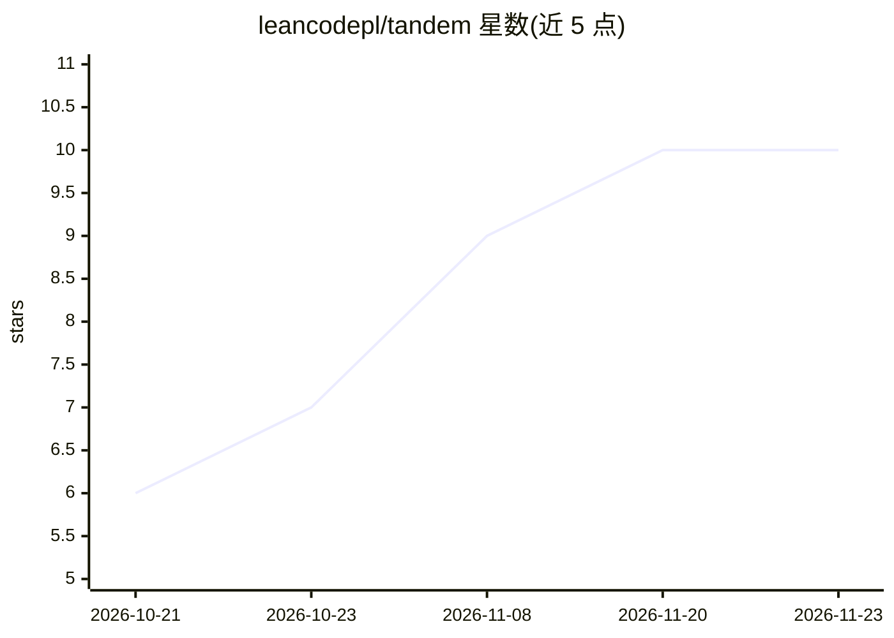

# leancodepl/tandem

⭐ 10 · Dart · Apache-2.0 · 推送 2026-11-20 · [GitHub](https://github.com/leancodepl/tandem) · [官网](https://pub.dev/packages/tandem) · 组织维护

**Flutter 包：让 AI agent 与用户在同一屏幕协作操作应用**

tandem 是一个 Flutter/Dart 包，开发者在状态类上声明 agent 可读取的数据与可调用的方法（.sees/.calls/.callsWithApproval），经 build_runner 生成代码，通过 AG-UI 协议连接 agent 后端，或经 TandemBridge 在 debug 构建中让编码 agent 直接调用应用方法。带审批标记的方法需用户在应用内确认后执行。可另加 TandemView 让 agent 用应用自有组件绘制界面。API 未到 1.0，README 标注为实验性。

## 筛选速览

| 维度 | 判定 | 备注 |
|---|---|---|
| AI 角色 | `ai-ecosystem` | LLM/agent 周边工具 |
| 许可风险 | `permissive` | Apache-2.0 |
| 部署形态 | `None` |  |
| 模型依赖 | — | README 未给出锁定关系 |
| 硬件要求 | — | 无带数字的原话,不猜 |
| 安装摩擦 | `low` | 无编译、无系统依赖或容器化 |
| 成熟度 | `idea` | |

## 能力要点

- 通过 AgentCapability 列表声明 agent 可见数据与可调用方法，复用按钮同一验证逻辑
- .callsWithApproval 方法须用户在应用内批准后运行
- 经 AG-UI 协议连接后端，README 称已与 Google ADK、LangGraph、Pydantic AI 核验
- TandemView 支持 agent 用应用自有 widget（@TandemCatalog 声明）绘制界面

## 适用场景

- 在运行中的 Flutter 应用里让编码 agent 代为填写表单
- 为应用内用户添加可调用屏幕方法的聊天 agent
- 下单等敏感操作要求用户逐一审批 agent 调用

## 场景标签

`Agent 框架` · 领域:Agent 开发

## 证据(README 行号)

> L20: Pick a screen. Its state class lists the data an AI agent can read and the methods it can call. Those methods use t
> L28: With a remote agent, your backend calls the model and keeps the API key. The app talks to the backend over AG-UI, a

## 星数曲线

2026-10-21 6 → 2026-11-23 10（+4）

---
*卡片 v1 · prompt 1.4 · 生成 2026-11-20 · 置信度 high · 依据 README sha `605c7a3b52fa` · [字段定义](../../DATASET.md)*
