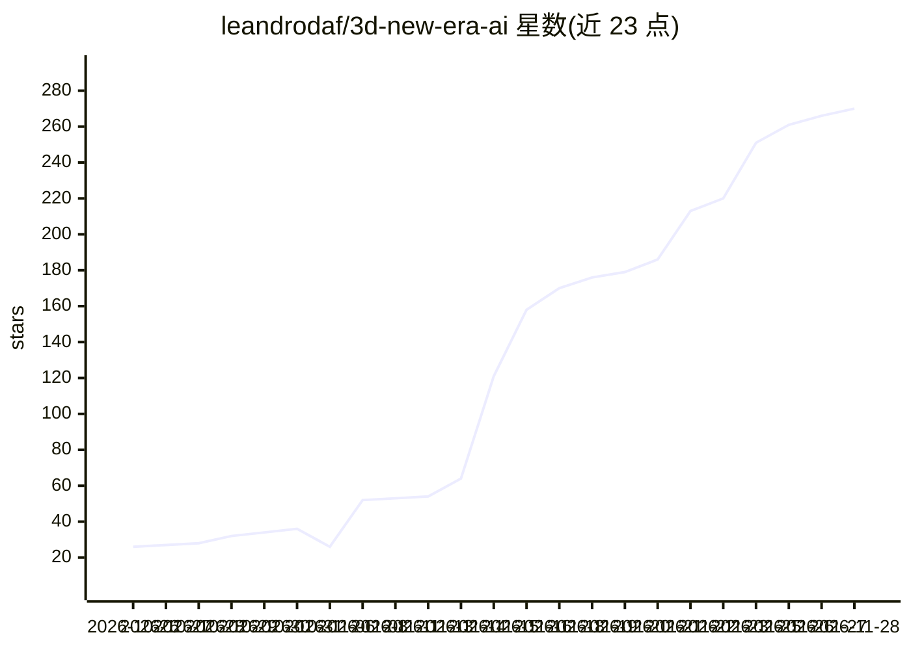

# leandrodaf/3d-new-era-ai

⭐ 270 · Rust · Apache-2.0 · 推送 2026-11-26 · [GitHub](https://github.com/leandrodaf/3d-new-era-ai) · [官网](https://3dneweraai.com) · 个人维护

**可让 AI agent 经 MCP 操作的 Rust 家装与户型编辑器**

用 Rust 编写的开源家居设计、户型与室内设计编辑器，提供 Windows/macOS/Linux 桌面应用与浏览器（WebGPU/WebGL）版本，内置 MCP 服务器（本地 127.0.0.1:7878 或托管 connector），使 Claude、ChatGPT、Codex 等 MCP 客户端可通过工具调用画墙、布置家具、检查人体工学与照度并渲染图片，改动实时显示且可撤销。支持读取 Sweet Home 3D 项目，导出 PDF/SVG/PNG/GLB/OBJ，桌面版与浏览器版免费且无需账号。

## 筛选速览

| 维度 | 判定 | 备注 |
|---|---|---|
| AI 角色 | `ai-enhanced` | 去掉 AI 部分产品仍成立 |
| 许可风险 | `permissive` | Apache-2.0 |
| 部署形态 | `desktop` | 安装包/桌面程序 |
| 模型依赖 | — | README 未给出锁定关系 |
| 硬件要求 | — | 无带数字的原话,不猜 |
| 安装摩擦 | `low` | 无编译、无系统依赖或容器化 |
| 成熟度 | — | 结构信号不足 |

## 能力要点

- 内置 MCP 服务器，AI 客户端通过 home/create/joinery/ergonomics/lighting 等工具直接编辑户型
- 参数化柜体与 cut_list 板材清单导出（CSV/DXF/SVG）
- 按 NBR 5410/5626/8160 等标准检查电气、水路与照度
- 渲染在 CPU 上进行，无头服务器也可出图

## 适用场景

- 让 AI agent 根据扫描户型图生成并布置房间
- 生成可施工的柜体下料清单与水电图
- 为设计方案渲染日照/夜景照片与鸟瞰剖切图
- 导入 Sweet Home 3D 项目继续编辑

## 场景标签

`AI 助手` `图像生成` `工作流自动化` · 领域:效率与自动化

## 证据(README 行号)

> L9: An open-source **home design, floor plan and interior design editor** written in Rust,
> L10: built so that **your AI can design with you**. It ships with a
> L25: |**Desktop app**|The full editor on your machine, with a local MCP server at `127.0.0.1:7878`. Nothing leaves your 

## 星数曲线

2026-10-26 26 → 2026-11-28 270（+244）

---
*卡片 v1 · prompt 1.4 · 生成 2026-11-28 · 置信度 high · 依据 README sha `336a02fb6953` · [字段定义](../../DATASET.md)*
