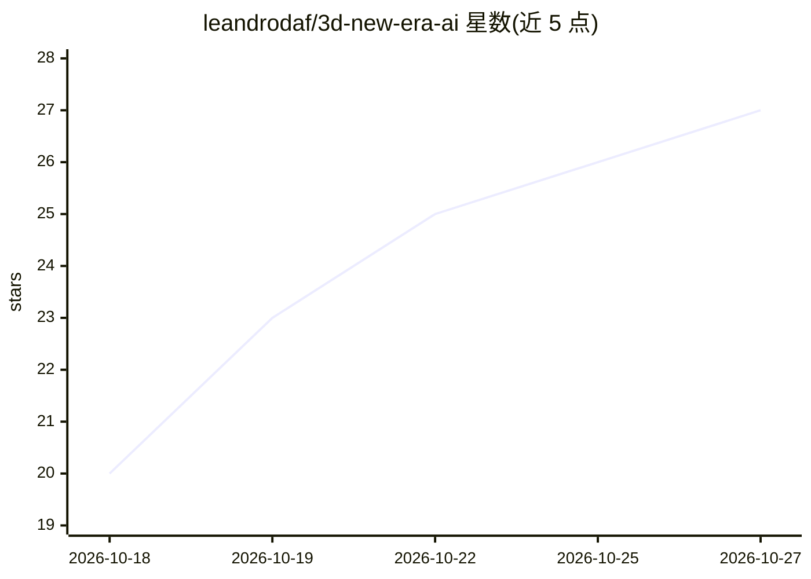

# leandrodaf/3d-new-era-ai

⭐ 27 · Rust · Apache-2.0 · 推送 2026-10-18 · [GitHub](https://github.com/leandrodaf/3d-new-era-ai) · [官网](https://leandrodaf.github.io/3d-new-era-ai/) · 个人维护

**带 MCP 服务器的开源住宅设计与平面图编辑器，让 AI 代你画图布置**

用 Rust 编写的开源住宅设计、平面图与室内设计编辑器（Sweet Home 3D 替代），内置 Model Context Protocol 服务器：Claude、ChatGPT、Codex、Gemini、Cursor 等 MCP 客户端可在本机上画墙、布置房间、生成参数化柜体、按 NBR 标准做照度与人体工学检查并渲染照片，改动实时显示且可撤销。提供 Windows/macOS/Linux 桌面安装包、浏览器编辑器与限额内免费的托管连接器三种使用方式；支持打开 .sh3d 项目，导出 PDF/SVG/PNG/GLB/OBJ。

## 筛选速览

| 维度 | 判定 | 备注 |
|---|---|---|
| AI 角色 | `ai-enhanced` | 去掉 AI 部分产品仍成立 |
| 许可风险 | `permissive` | Apache-2.0 |
| 部署形态 | `desktop` | 安装包/桌面程序 |
| 模型依赖 | locked-api |  |
| 硬件要求 | — | 无带数字的原话,不猜 |
| 安装摩擦 | `low` | 无编译、无系统依赖或容器化 |
| 成熟度 | — | 结构信号不足 |

## 能力要点

- 内置 MCP 服务器（127.0.0.1:7878），20+ 个读写分离的工具供 AI 客户端调用
- 扫描平面图按真实比例找墙生成，参数化柜体可导出 CSV/DXF/SVG 开料单
- 按 NBR 标准做照度（NBR ISO/CIE 8995-1）与人体工学检查，电气/水暖平面与规范校验
- CPU 路径追踪渲染，无头服务器也可渲染；多人同项目协作与插件 HTTP API

## 适用场景

- 让 Claude/Cursor 等 AI 客户端通过对话完成户型绘制、家具布置与渲染
- 室内设计师导入扫描平面图或 Sweet Home 3D 项目继续深化设计
- 木工车间用开料单工具输出柜体板材清单

## 场景标签

`AI 助手` · 领域:对话与助手

## 证据(README 行号)

> L9: An open-source **home design, floor plan and interior design editor** written in Rust,
> L16: A Sweet Home 3D alternative for Windows, macOS, Linux and the browser, in English,

## 星数曲线

2026-10-18 20 → 2026-10-27 27（+7）

---
*卡片 v1 · prompt 1.4 · 生成 2026-10-26 · 置信度 high · 依据 README sha `f5f899c4e265` · [字段定义](../../DATASET.md)*
