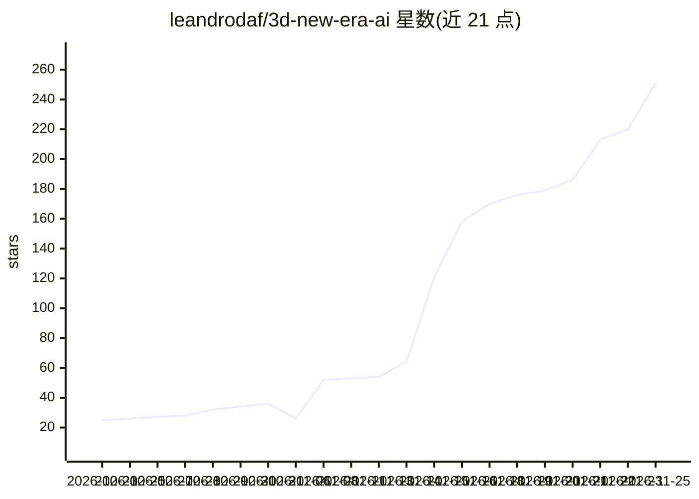

# leandrodaf/3d-new-era-ai

⭐ 251 · Rust · Apache-2.0 · 推送 2026-11-22 · [GitHub](https://github.com/leandrodaf/3d-new-era-ai) · [官网](https://3dneweraai.com) · 个人维护

**开源家居设计/户型编辑器，内置 MCP 让 AI 代画代渲染**

Rust 编写的家居设计、户型与室内设计编辑器，提供 Windows/macOS/Linux 桌面应用、浏览器版（WebGPU/WebGL）与托管连接器三种使用方式。内置 MCP 服务器（桌面默认 127.0.0.1:7878），供 Claude、ChatGPT、Cursor 等 MCP 客户端调用约 20 个工具：画墙、摆放家具、定制柜体、按 NBR 标准检查人体工学与照明、生成电气水路图并渲染照片。功能含扫描户型识别墙体、导出 CSV/DXF/SVG/PDF/GLB/OBJ，支持多人协作与任意语言的 HTTP 插件。

## 筛选速览

| 维度 | 判定 | 备注 |
|---|---|---|
| AI 角色 | `ai-enhanced` | 去掉 AI 部分产品仍成立 |
| 许可风险 | `permissive` | Apache-2.0 |
| 部署形态 | `desktop` | 安装包/桌面程序 |
| 模型依赖 | — | README 未给出锁定关系 |
| 硬件要求 | — | 无带数字的原话,不猜 |
| 安装摩擦 | `low` | 无编译、无系统依赖或容器化 |
| 成熟度 | — | 结构信号不足 |

## 能力要点

- 内置 MCP 服务器，读/改工具分离，改动可撤销且 token 占用低
- 参数化柜体与 cabinet_run 整墙填充，cut_list 导出 CSV/DXF/SVG 下料单
- 按 NBR 5410/5626/8160 与 NBR ISO/CIE 8995-1 做电气、水路与照度检查
- CPU 路径追踪渲染照片与视频，无头服务器亦可执行

## 适用场景

- 让 AI 助手根据扫描户型图自动画墙、布置家具并渲染效果图
- 装修前对比多个方案版本并回滚检查点
- 为施工方导出下料单与电气水路图

## 场景标签

 · 领域:建筑/家居设计工具

## 证据(README 行号)

> L9: An open-source **home design, floor plan and interior design editor** written in Rust,
> L10: built so that **your AI can design with you**. It ships with a
> L86: **With the desktop app.** The editor serves MCP at `http://127.0.0.1:7878/mcp` while it is

## 星数曲线

2026-10-23 25 → 2026-11-25 251（+226）

---
*卡片 v1 · prompt 1.4 · 生成 2026-11-25 · 置信度 high · 依据 README sha `c3f030fada11` · [字段定义](../../DATASET.md)*
