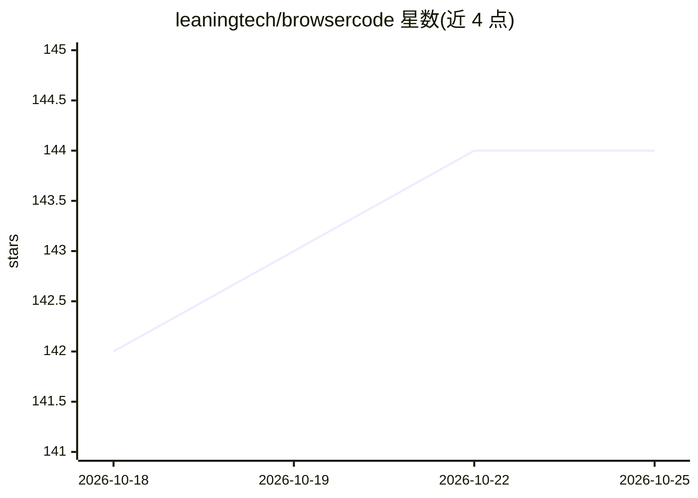

# leaningtech/browsercode

⭐ 145 · Svelte · Apache-2.0 · 推送 2026-10-23 · [GitHub](https://github.com/leaningtech/browsercode) · [官网](https://browsercode.io) · 组织维护

**在浏览器沙箱中运行 AI 编程 CLI 与全栈框架原型的 Web IDE**

基于 WebAssembly 沙箱 BrowserPod 的浏览器端编程操场：以未修改形态在纯客户端运行 Claude Code、Codex CLI、Pi 等 AI 编程 CLI，并提供 Node.js/Rust/Python 运行时、POSIX 类文件系统、bash/git/npm 等命令行工具，可启动并预览 Svelte/Next/React 等框架模板。出站网络限 HTTPS 且仅限白名单（npm registry、GitHub、主流 AI 提供商 API）。提供托管版 browsercode.io，也可克隆源码本地运行，支持 iframe 嵌入。当前为 beta，不支持原生二进制，需 Chromium 浏览器。

## 筛选速览

| 维度 | 判定 | 备注 |
|---|---|---|
| AI 角色 | `ai-ecosystem` | LLM/agent 周边工具 |
| 许可风险 | `permissive` | Apache-2.0 |
| 部署形态 | `library` | 以包/库形式分发 |
| 模型依赖 | — | README 未给出锁定关系 |
| 硬件要求 | — | 无带数字的原话,不猜 |
| 安装摩擦 | `low` | 无编译、无系统依赖或容器化 |
| 成熟度 | `idea` | |

## 能力要点

- 未修改的 Claude Code / Codex CLI / Pi 纯客户端运行
- 多语言 WebAssembly 沙箱（Node.js/Rust/Python 预览）与浏览器内 POSIX 类文件系统
- 允许列表制的 HTTPS 出站网络限制
- iframe /embed 查询字符串参数化嵌入

## 适用场景

- 免安装试用 AI 编程 CLI 与快速原型全栈应用
- 在浏览器内启动 agent 并直接预览其生成的框架代码
- 把编程操场嵌入自己的网站页面

## 场景标签

 · 领域:开发者工具/浏览器沙箱

## 证据(README 行号)

> L11:  Run AI coding CLIs and frameworks in the browser
> L31: BrowserCode started out as a way to run AI coding CLIs entirely client-side. It's since grown into a full IDE: alon
> L33: BrowserCode 1.3.0 is our latest beta release. It runs a full code editor, development environment, and unmodified v

## 星数曲线

2026-10-18 142 → 2026-10-25 144（+2）

---
*卡片 v1 · prompt 1.4 · 生成 2026-10-22 · 置信度 high · 依据 README sha `5788f1b485d8` · [字段定义](../../DATASET.md)*
