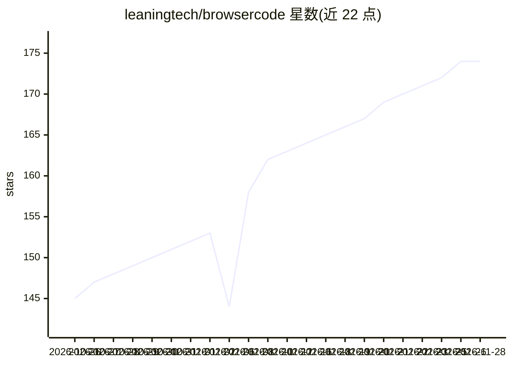

# leaningtech/browsercode

⭐ 174 · Svelte · Apache-2.0 · 推送 2026-11-27 · [GitHub](https://github.com/leaningtech/browsercode) · [官网](https://browsercode.io) · 组织维护

**在浏览器端运行 AI 编码 CLI 的 WebAssembly 沙盒 IDE**

BrowserCode 是基于 BrowserPod（多语言 WebAssembly 沙盒，含 Node.js v22、Rust、Python preview）的浏览器内编码沙盒，可在客户端直接运行未经修改的 Claude Code、Codex CLI 与 Pi，并提供代码编辑器、类 POSIX 文件系统、bash/git/npm 等命令行工具与即时预览，用于全栈应用原型与分享。出站网络仅限白名单（npm registry、GitHub 及主流 AI 提供商 API）。尚处 beta，不支持原生二进制，Agent 运行需支持 JSPI 的浏览器，iOS/iPadOS 暂不可用；自托管需 BrowserPod API key。

## 筛选速览

| 维度 | 判定 | 备注 |
|---|---|---|
| AI 角色 | `ai-ecosystem` | LLM/agent 周边工具 |
| 许可风险 | `permissive` | Apache-2.0 |
| 部署形态 | `library` | 以包/库形式分发 |
| 模型依赖 | — | README 未给出锁定关系 |
| 硬件要求 | — | 无带数字的原话,不猜 |
| 安装摩擦 | `low` | 无编译、无系统依赖或容器化 |
| 成熟度 | `idea` | |

## 能力要点

- 完全客户端运行 Claude Code、Codex CLI、Pi（无需服务器与云算力）
- 基于 BrowserPod 的多语言 WebAssembly 沙盒（Node.js/Rust/Python）
- 出站网络白名单限制，含 npm registry、GitHub 与主流 AI 提供商 API
- 支持 Vite、Express.js、Svelte、Next、Nuxt、React、Vue 的浏览器内启动与预览

## 适用场景

- 在浏览器中原型化 AI agent 生成的代码并即时预览
- 不安装本地环境即可试用 AI 编码 CLI
- 通过 /embed 将沙盒或 Java 运行时嵌入第三方页面

## 场景标签

`编码 Agent` · 领域:编码与开发

## 证据(README 行号)

> L11:  Run AI coding CLIs and frameworks in the browser
> L13:  BrowserCode is a browser-based playground for fast-prototyping full-stack apps and sharing them instantly. It runs
> L32: BrowserCode started out as a way to run AI coding CLIs entirely client-side. It's since grown into a full IDE: alon

## 星数曲线

2026-10-26 145 → 2026-11-28 174（+29）

---
*卡片 v1 · prompt 1.4 · 生成 2026-11-28 · 置信度 high · 依据 README sha `df5f88b5e538` · [字段定义](../../DATASET.md)*
