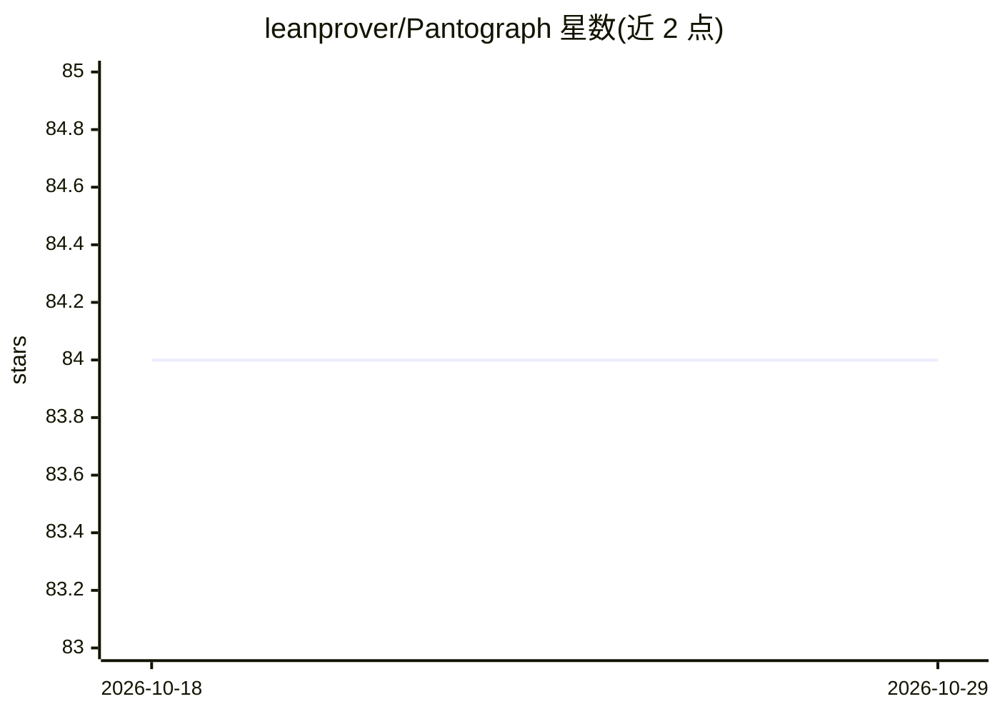

# leanprover/Pantograph

⭐ 84 · Lean · Apache-2.0 · 推送 2026-10-20 · [GitHub](https://github.com/leanprover/Pantograph) · [官网](https://git.leni.sh/aniva/Pantograph) · 组织维护

**Lean 4 机器对机器交互系统：提供 REPL 与 FFI 接口**

面向程序与外部系统（含自动化/AI 进程）的 Lean 4 交互层：通过 REPL 或共享库/FFI 接口访问 Lean 前端、执行证明、构造表达式并检查 Lean 环境；附带 tomograph 可执行文件，处理 Lean 文件并显示语法或详述层数据。Nix 用户可用 nix build 构建，非 Nix 用户需安装 lean-toolchain 指定版本的 lake 与 lean 后运行 lake build。以可执行文件与 Lean 库两种形式提供。

## 筛选速览

| 维度 | 判定 | 备注 |
|---|---|---|
| AI 角色 | `ai-ecosystem` | LLM/agent 周边工具 |
| 许可风险 | `permissive` | Apache-2.0 |
| 部署形态 | `None` |  |
| 模型依赖 | — | README 未给出锁定关系 |
| 硬件要求 | — | 无带数字的原话,不猜 |
| 安装摩擦 | `low` | 无编译、无系统依赖或容器化 |
| 成熟度 | — | 结构信号不足 |

## 能力要点

- REPL 与 FFI 库两种交互方式，命令与函数非一一对应
- 可执行证明、构造表达式、检查 Lean 环境
- tomograph 显示 Lean 文件的语法/详述层数据

## 适用场景

- 让外部程序自动化驱动 Lean 证明过程
- 构建基于 Lean 的证明自动化或 AI agent 接口
- 分析 Lean 文件的详述信息

## 场景标签

 · 领域:形式化验证/定理证明

## 证据(README 行号)

> L3: A Machine-to-Machine interaction system for Lean 4.
> L7: Pantograph provides interfaces to interact with Lean's frontend, execute proofs,

## 星数曲线

2026-10-18 84 → 2026-10-29 84（+0）

---
*卡片 v1 · prompt 1.4 · 生成 2026-10-24 · 置信度 high · 依据 README sha `3cb3421ad185` · [字段定义](../../DATASET.md)*
