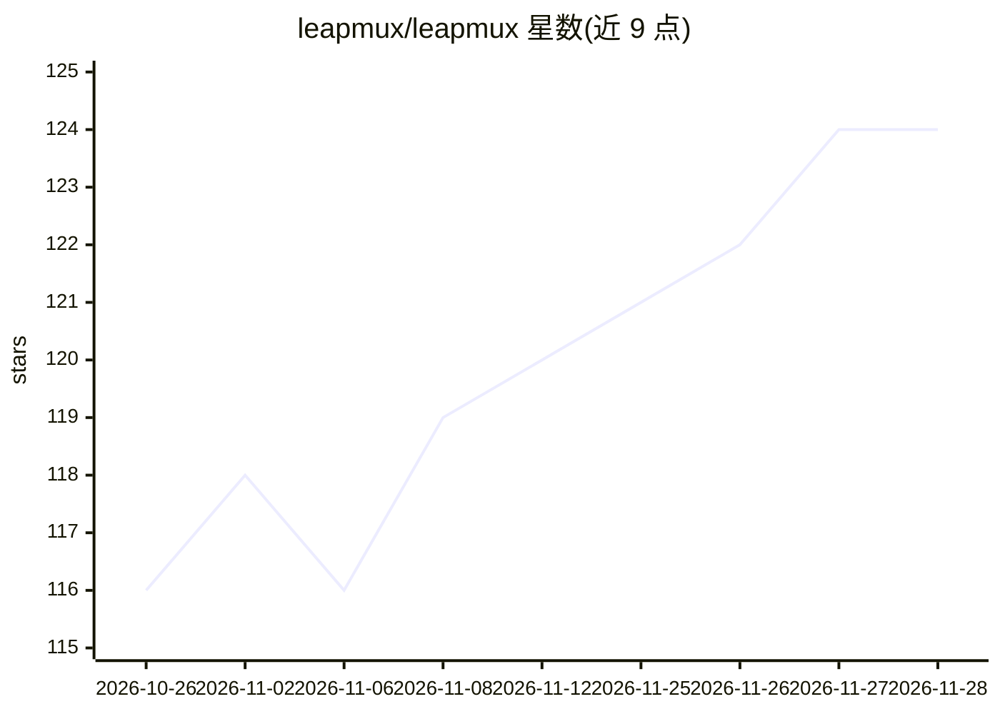

# leapmux/leapmux

⭐ 124 · Go · NOASSERTION · 推送 2026-11-27 · [GitHub](https://github.com/leapmux/leapmux) · [官网](https://leapmux.dev) · 组织维护 · 中文 README

**在同一工作区运行多个 AI 编码 Agent 的多路复用器**

LeapMux 在一个工作区中并行运行多个编码 Agent 与 shell 终端，为每个 Agent 分配独立的 git worktree 和分支，以平铺或浮动窗口排列视图，会话在重启后保持附着，Frontend↔Worker 流量端到端加密。架构为一个 Go 二进制（solo/hub/worker/dev 等模式）、SolidJS 前端与 Tauri 桌面外壳；Hub 管理登录与工作区并经 relay 转发加密流量，Worker 主动外连 Hub 因此可位于 NAT 后。面向需要在多 Agent 间保持分支与工作树隔离的开发者。

## 筛选速览

| 维度 | 判定 | 备注 |
|---|---|---|
| AI 角色 | `ai-ecosystem` | LLM/agent 周边工具 |
| 许可风险 | `none` | NOASSERTION |
| 部署形态 | `desktop` | 安装包/桌面程序 |
| 模型依赖 | — | README 未给出锁定关系 |
| 硬件要求 | — | 无带数字的原话,不猜 |
| 安装摩擦 | `low` | 无编译、无系统依赖或容器化 |
| 成熟度 | — | 结构信号不足 |

## 能力要点

- 30+ 种编码 Agent 的统一运行与视图管理（Claude Code、Codex、Cursor、Gemini CLI 等）
- 每个 Agent 绑定独立 git worktree 与分支，避免共享工作树互相覆盖
- Hub/Worker 架构：Worker 出站连接可穿透 NAT，Frontend↔Worker 端到端加密（混合后量子 Noise_NK）
- 浏览器与 Tauri 桌面应用两种使用形态，会话跨重启保持

## 适用场景

- 同时运行三四个编码 Agent 时追踪各 Agent 所属分支
- 隔离各 Agent 的工作树防止互相覆盖
- 远程机器上的 Agent 会话经加密 relay 在本地浏览器操作

## 场景标签

`编码 Agent` · 领域:编码与开发

## 证据(README 行号)

> L16: LeapMux runs several coding agents and shell terminals in one workspace.
> L23: ## Supported Agents
> L80: - **Worker** — A Go process that keeps its own SQLite database. It connects **outbound** to the Hub, so it can oper

## 星数曲线

2026-10-26 116 → 2026-11-28 124（+8）

---
*卡片 v1 · prompt 1.4 · 生成 2026-11-28 · 置信度 mid · 依据 README sha `5375e45c5b6a` · [字段定义](../../DATASET.md)*
