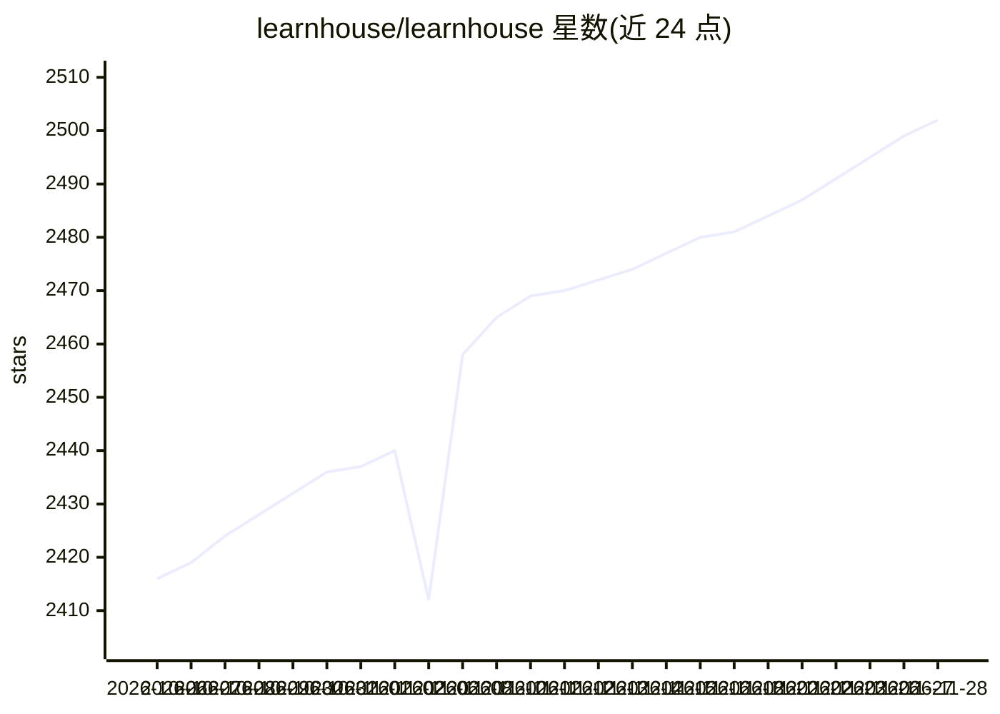

# learnhouse/learnhouse

⭐ 2,502 · Python · AGPL-3.0 · 推送 2026-11-27 · [GitHub](https://github.com/learnhouse/learnhouse) · [官网](https://learnhouse.app) · 个人维护

**开源 LMS 学习平台：课程、测评与 AI 辅导一体**

面向机构与个人的开源学习平台，提供块编辑器课程创作（实时协作）、测验与作业（30+ 语言代码题自动评分）、播客、证书、学习路径、社区、22 语言界面。AI 部分包括课程大纲生成、课程内容问答导师与评分辅助，支持 Gemini 或通过 Ollama 接入本地模型。通过 CLI+Docker 一键部署，提供 REST API、webhooks、MCP server 及 React/Vue/SDK 前端包；企业版另行提供 Atlas agent、支付、SSO 等功能。

## 筛选速览

| 维度 | 判定 | 备注 |
|---|---|---|
| AI 角色 | `ai-enhanced` | 去掉 AI 部分产品仍成立 |
| 许可风险 | `viral` | AGPL-3.0 |
| 部署形态 | `library` | 以包/库形式分发 |
| 模型依赖 | local-ok | 支持本地模型 |
| 硬件要求 | — | 无带数字的原话,不猜 |
| 安装摩擦 | `low` | 无编译、无系统依赖或容器化 |
| 成熟度 | — | 结构信号不足 |

## 能力要点

- 课程大纲生成与基于课程内容的 AI 导师
- AI 模型可选 Gemini 或经 Ollama 的本地模型
- 块编辑器实时协作，测验/作业在 30+ 语言自动评分
- REST API、webhooks、MCP server 与 React/Vue/SDK 嵌入包

## 适用场景

- 搭建自己的在线学院或课程网站
- 在课程中启用基于教材内容的 AI 辅导
- 把课程活动嵌入已有的 React/Vue 应用或移动端

## 场景标签

`文档问答` · 领域:知识与检索

## 证据(README 行号)

> L63: |🤖 **AI**|Course planner, lesson tutor and grading help, with Gemini or a local model through Ollama|
> L73: Everything above is open source and free forever. Teams that sell courses, train staff or plug into a school's syst
> L164: Needs Node.js 22+ and Docker with Compose v2. Every command is in the CLI docs.

## 星数曲线

2026-10-26 2,416 → 2026-11-28 2,502（+86）

---
*卡片 v1 · prompt 1.4 · 生成 2026-11-23 · 置信度 high · 依据 README sha `20556bed4ec9` · [字段定义](../../DATASET.md)*
