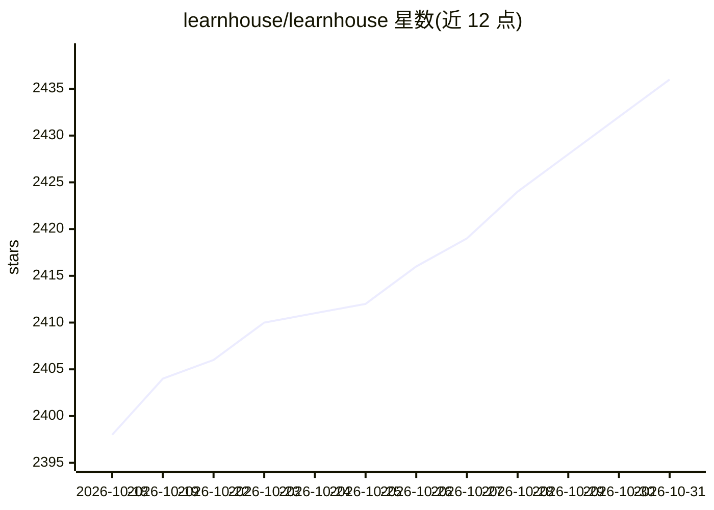

# learnhouse/learnhouse

⭐ 2,436 · Python · AGPL-3.0 · 推送 2026-10-25 · [GitHub](https://github.com/learnhouse/learnhouse) · [官网](https://learnhouse.app) · 个人维护

**开源自托管在线学习平台（LMS），含 AI 辅助教学功能**

面向教师、学生与管理员的开源学习平台，以 monorepo 形式提供 Web 前端、FastAPI 后端、实时协作服务器与官方 CLI。功能覆盖课程管理、Notion 式块编辑器、作业与提交追踪、讨论区、播客、30+ 语言代码自动评分、协作白板与证书生成。AI 部分：AI 生成的交互式模拟与图表（Playgrounds）以及面向学习/教学的上下文感知 AI（技术栈含 Gemini 与 LlamaIndex）。通过 npx learnhouse 命令自托管，自动拉起 PostgreSQL 与 Redis；企业功能（支付/SSO/多组织）采用单独的企业许可。

## 筛选速览

| 维度 | 判定 | 备注 |
|---|---|---|
| AI 角色 | `ai-enhanced` | 去掉 AI 部分产品仍成立 |
| 许可风险 | `dual` | AGPL-3.0 |
| 部署形态 | `library` | 以包/库形式分发 |
| 模型依赖 | — | README 未给出锁定关系 |
| 硬件要求 | — | 无带数字的原话,不猜 |
| 安装摩擦 | `low` | 无编译、无系统依赖或容器化 |
| 成熟度 | — | 结构信号不足 |

## 能力要点

- 块式 Notion 风格内容编辑器与实时协作（Yjs）
- 30+ 语言真实代码执行与自动评分
- AI 生成交互式元素与上下文感知 AI 学习/教学功能
- 官方 CLI 覆盖自托管、更新、备份与本地开发

## 适用场景

- 学校或机构自托管在线课程与作业平台
- 教师在平台上编写课程内容并追踪学生学习数据
- 编程教学场景下自动评分学生代码作业

## 场景标签

 · 领域:教育/在线学习平台

## 证据(README 行号)

> L5:  The next-gen open-source platform for world-class educational content.
> L22: 🧊 Playgrounds : AI-generated interactive elements, simulations & diagrams
> L25: 🧠 AI : Context-aware AI for learning & teaching

## 星数曲线

2026-10-18 2,398 → 2026-10-31 2,436（+38）

---
*卡片 v1 · prompt 1.4 · 生成 2026-10-21 · 置信度 high · 依据 README sha `b2dcf0529781` · [字段定义](../../DATASET.md)*
