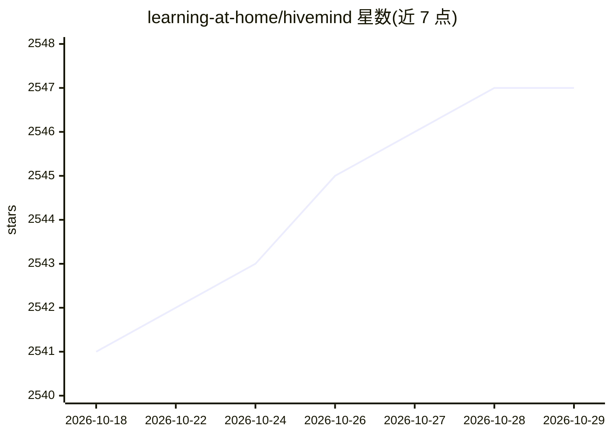

# learning-at-home/hivemind

⭐ 2,547 · Python · MIT · 推送 2026-01-11 · [GitHub](https://github.com/learning-at-home/hivemind) · 组织维护

**PyTorch 去中心化分布式训练库：跨互联网协同训练大模型**

面向在数百台跨机构、跨地域计算机上训练单个大模型的场景，提供基于分布式哈希表（DHT）的无主节点组网、容错前向/反向传播、无需全网同步的去中心化参数 averaging（Moshpit SGD），以及可把层分布到各参与者的去中心化 Mixture-of-Experts 层，从而训练任意规模网络。以 pip/源码安装的 Python 库提供，附带 PyTorch Lightning 集成与 ALBERT 协同训练示例。默认在 Linux 开发测试，macOS 部分支持，Windows 需经 WSL 运行；底层依赖 go-libp2p 守护进程预编译二进制，可选自行编译（需 Go 工具链）。

## 筛选速览

| 维度 | 判定 | 备注 |
|---|---|---|
| AI 角色 | `ai-ecosystem` | LLM/agent 周边工具 |
| 许可风险 | `permissive` | MIT |
| 部署形态 | `library` | 以包/库形式分发 |
| 模型依赖 | — | README 未给出锁定关系 |
| 硬件要求 | — | 无带数字的原话,不猜 |
| 安装摩擦 | `low` | 无编译、无系统依赖或容器化 |
| 成熟度 | — | 结构信号不足 |

## 能力要点

- 基于 DHT 的无主节点分布式训练
- 节点失效或响应缓慢时仍可完成前向/反向传播
- 去中心化参数 averaging 无需全网同步
- 去中心化 Mixture-of-Experts 支持把层分布到各参与者

## 适用场景

- 跨机构/志愿者节点协同训练一个大模型
- 在不可靠慢速网络下改造现有 PyTorch 训练流水线
- 构建多人协作的模型预训练或微调项目

## 场景标签

`模型训练` · 领域:训练与推理

## 证据(README 行号)

> L10: Hivemind is a PyTorch library for decentralized deep learning across the Internet. Its intended usage is training o
> L17: * Distributed training without a master node: Distributed Hash Table allows connecting computers in a decentralized

## 星数曲线

2026-10-18 2,541 → 2026-10-29 2,547（+6）

---
*卡片 v1 · prompt 1.4 · 生成 2026-10-21 · 置信度 high · 依据 README sha `b3b2cc60c748` · [字段定义](../../DATASET.md)*
