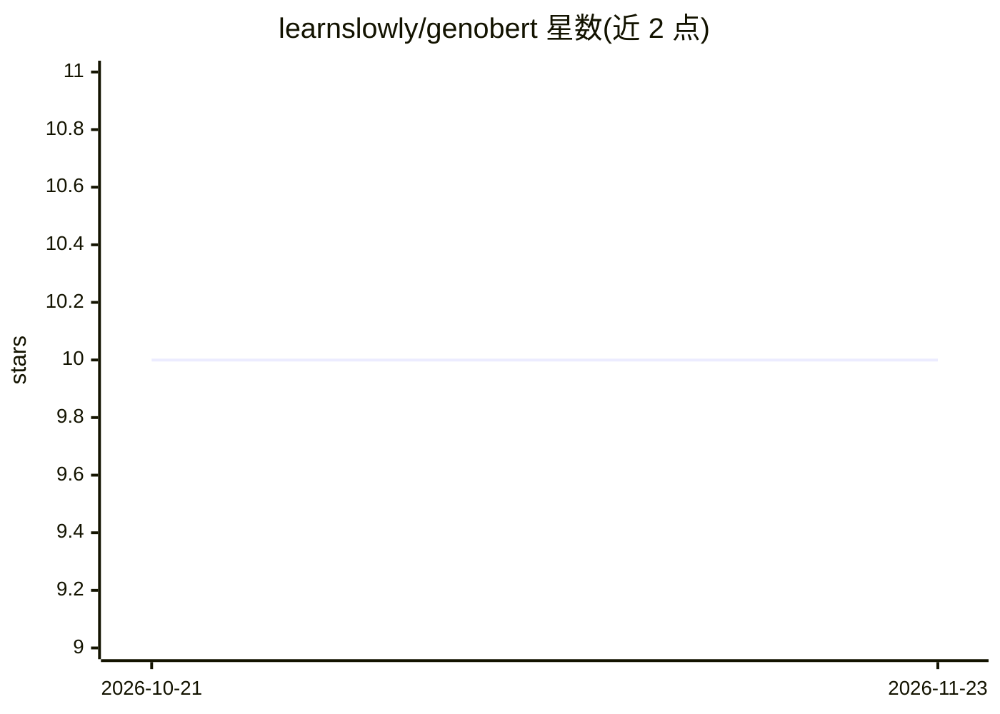

# learnslowly/genobert

⭐ 10 · Python · MIT · 推送 2026-05-02 · [GitHub](https://github.com/learnslowly/genobert) · 个人维护

**基于 BERT 的基因型填补深度学习模型**

将基因型序列视为语言建模问题的 BERT 类模型：采用 ALBERT 架构，把每个 SNP 基因型作为 token，通过掩码语言建模学习连锁不平衡（LD）模式以填补缺失基因型。机制上引入基因组物理距离偏置注意力（RGPB）、可选稀疏注意力、重叠窗口染色体分段与 focal loss 类平衡训练。README 提供从 VCF 数据准备、文件合并、预训练到测试的完整教程，支持单 GPU、SLURM 集群与 torchrun 多卡训练，可自定义数据集（如 LOS）。面向基因组学与生物信息学研究者。

## 筛选速览

| 维度 | 判定 | 备注 |
|---|---|---|
| AI 角色 | `ai-native` | 本体是模型或模型工具 |
| 许可风险 | `permissive` | MIT |
| 部署形态 | `library` | 以包/库形式分发 |
| 模型依赖 | — | README 未给出锁定关系 |
| 硬件要求 | — | 无带数字的原话,不猜 |
| 安装摩擦 | `medium` | 含编译或系统依赖之一 |
| 成熟度 | — | 结构信号不足 |

## 能力要点

- 掩码语言建模预训练用于基因型填补
- 注意力中融入基因组物理距离（RGPB）与可选稀疏注意力
- 支持 SLURM/torchrun 多 GPU 训练与 WandB 日志
- focal loss 处理常见与稀有等位基因不平衡

## 适用场景

- 在 1000 Genomes 数据集上训练基因型填补模型
- 在自定义队列数据（如 LOS）上预训练与评估
- HPC 集群上批量准备基因数据并训练模型

## 场景标签

`模型训练` · 领域:训练与推理

## 证据(README 行号)

> L8: GenoBERT is a BERT-based deep learning model that treats genotype sequences as a language modeling problem. By lever
> L12: GenoBERT adapts the ALBERT architecture for genomic sequences, treating each SNP genotype as a token in a sequence.

## 星数曲线

2026-10-21 10 → 2026-11-23 10（+0）

---
*卡片 v1 · prompt 1.4 · 生成 2026-11-19 · 置信度 mid · 依据 README sha `7dc2237bb844` · [字段定义](../../DATASET.md)*
