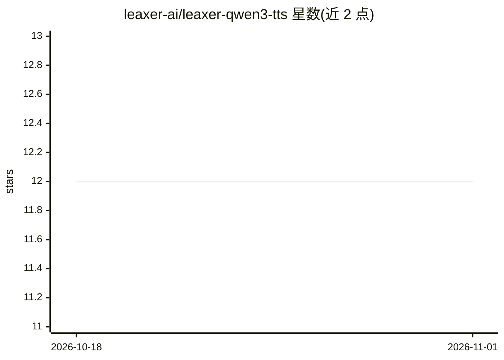

# leaxer-ai/leaxer-qwen3-tts

⭐ 12 · C++ · Apache-2.0 · 推送 2026-01-30 · [GitHub](https://github.com/leaxer-ai/leaxer-qwen3-tts) · 组织维护

**Qwen3-TTS 的 C++/ONNX Runtime 单文件推理引擎**

以单个 C++ 二进制实现 Qwen3-TTS 语音合成，基于 ONNX Runtime 运行：读取文本与模型目录，经 BPE 分词、Talker prefill/decode（KV cache）、Code Predictor 生成 16 个 12Hz codebook，再由 vocoder 上采样输出 24kHz WAV。支持 en/zh/ja/ko 语言提示、温度/top-k/top-p 采样参数，以及用 3 秒参考音频做声音克隆。模型需从 zukky/Qwen3-TTS-ONNX-DLL 下载，ONNX Runtime 由用户自备；通过 CMake 从源码构建，macOS 可用 Homebrew 安装依赖，支持 CoreML 等 GPU 加速。Apache 2.0 许可。

## 筛选速览

| 维度 | 判定 | 备注 |
|---|---|---|
| AI 角色 | `ai-native` | 本体是模型或模型工具 |
| 许可风险 | `permissive` | Apache-2.0 |
| 部署形态 | `None` |  |
| 模型依赖 | — | README 未给出锁定关系 |
| 硬件要求 | — | 无带数字的原话,不猜 |
| 安装摩擦 | `medium` | 含编译或系统依赖之一 |
| 成熟度 | — | 结构信号不足 |

## 能力要点

- C++ 实现 Qwen3-TTS，输出 24kHz WAV 音频
- 3 秒参考音频声音克隆，支持多格式 PCM 重采样
- 温度/top-k/top-p/max-tokens 采样参数可调
- CoreML 等 GPU 加速（需对应 execution provider 的 ONNX Runtime）

## 适用场景

- 本地离线运行 Qwen3-TTS 合成语音
- 用参考音频样本克隆特定音色
- 在 C++ 项目中集成轻量 TTS 推理

## 场景标签

`语音合成` `推理引擎` · 领域:内容生成

## 证据(README 行号)

> L3: Single binary, C++ implementation of Qwen3-TTS running on top of ONNX Runtime.
> L88: Text → BPE Tokenizer → Talker (prefill/decode) → Code Predictor → Vocoder → WAV

## 星数曲线

2026-10-18 12 → 2026-11-01 12（+0）

---
*卡片 v1 · prompt 1.4 · 生成 2026-11-01 · 置信度 high · 依据 README sha `e46fbde1b7de` · [字段定义](../../DATASET.md)*
