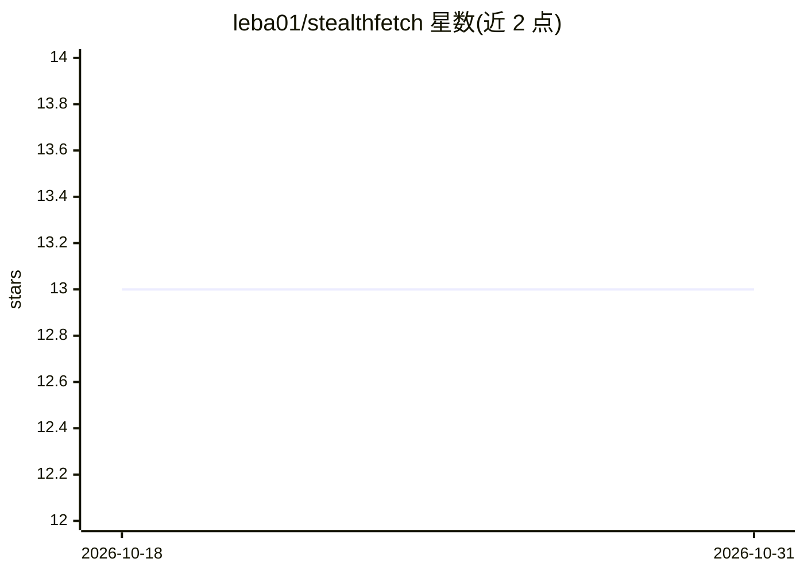

# leba01/stealthfetch

⭐ 13 · Python · NOASSERTION · 推送 2026-04-03 · [GitHub](https://github.com/leba01/stealthfetch) · [官网](https://pypi.org/project/stealthfetch/) · 个人维护

**给 LLM/Agent 用的网页抓取库：URL 进，干净 markdown 出**

Python 网页抓取与清洗库，同时可作为 MCP server 供 Claude Desktop、Claude Code、Cursor 等 MCP 客户端调用。先以带 Chrome TLS 指纹的 HTTP 请求抓取，检测到 Cloudflare/DataDome/PerimeterX/Akamai 拦截时自动升级到 Camoufox/Patchright 隐身浏览器；内置请求前与重定向后的双重 SSRF 校验（防 DNS rebinding 与内网/云元数据地址命中）。Reddit、Amazon 等站点仍会被拦截，需代理轮换。提供同步/异步 API、CLI 与 uvx 免安装运行。

## 筛选速览

| 维度 | 判定 | 备注 |
|---|---|---|
| AI 角色 | `ai-ecosystem` | LLM/agent 周边工具 |
| 许可风险 | `dual` | NOASSERTION |
| 部署形态 | `library` | 以包/库形式分发 |
| 模型依赖 | — | README 未给出锁定关系 |
| 硬件要求 | — | 无带数字的原话,不猜 |
| 安装摩擦 | `low` | 无编译、无系统依赖或容器化 |
| 成熟度 | — | 结构信号不足 |

## 能力要点

- 拦截检测（状态码+两档签名匹配）与自动升级隐身浏览器
- 请求前与重定向后双重 SSRF 校验，覆盖 DNS rebinding 场景
- MCP server 模式仅注册 1 个工具，约 400 token 系统提示开销
- FetchResult 结构化返回 markdown 及标题/作者/日期等元数据

## 适用场景

- 为 LLM Agent/RAG 流水线提供网页转 markdown 的抓取工具
- 通过 MCP 客户端（Claude Code/Cursor 等）作为网页获取后端
- 在受 Cloudflare/DataDome 保护的站点上自动切换隐身浏览器抓取

## 场景标签

`网页抓取` · 领域:效率与自动化

## 证据(README 行号)

> L129: StealthFetch is an MCP server. Any MCP client (Claude Desktop, Claude Code, Cursor, etc.) can call it as a tool to
> L8: URL in, LLM-ready markdown out.

## 星数曲线

2026-10-18 13 → 2026-10-31 13（+0）

---
*卡片 v1 · prompt 1.4 · 生成 2026-10-31 · 置信度 high · 依据 README sha `7a552d83053c` · [字段定义](../../DATASET.md)*
