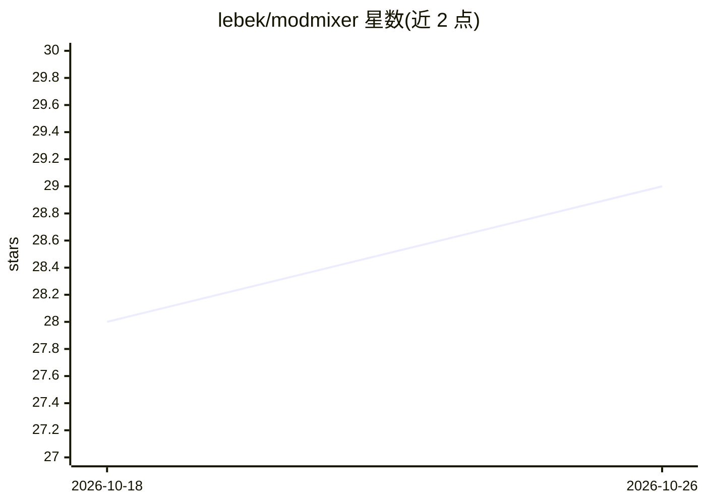

# lebek/modmixer

⭐ 29 · TypeScript · MIT · 推送 2026-08-12 · [GitHub](https://github.com/lebek/modmixer) · [官网](https://modmixer.com) · 个人维护

**桌面应用：用对话让 AI agent 构建 RimWorld 模组**

面向 RimWorld 玩家与模组作者的桌面应用：用户以自然语言描述模组想法，由接入的外部 LLM（如 Claude、ChatGPT）驱动 agent 编辑 Mods 文件夹中的 XML 与 C# 文件、导入精灵/纹理/音频资源、自动启动游戏测试、通过 'Modmixer Bridge' 模监控游戏日志中的错误并自动修复，最后辅助发布到 Steam Workshop。本产品自身不内置模型，需用户连接 AI 提供商。安装方式为从 modmixer.com 下载安装包。

## 筛选速览

| 维度 | 判定 | 备注 |
|---|---|---|
| AI 角色 | `ai-enhanced` | 去掉 AI 部分产品仍成立 |
| 许可风险 | `permissive` | MIT |
| 部署形态 | `None` |  |
| 模型依赖 | — | README 未给出锁定关系 |
| 硬件要求 | — | 无带数字的原话,不猜 |
| 安装摩擦 | `low` | 无编译、无系统依赖或容器化 |
| 成熟度 | — | 结构信号不足 |

## 能力要点

- 自然语言描述模组需求，agent 生成计划并自动编写 XML/C#
- 通过 Modmixer Bridge 模监控游戏日志错误并自动修复
- 自动导入精灵、纹理、音频并按 RimWorld 目录结构组织
- 辅助发布模组到 Steam Workshop

## 适用场景

- 不写代码就做一个自定义模组（如添加新武器类型）
- 写代码的模组作者让 agent 处理脚手架、def 查询和日志排查等重复工作
- 构建-测试-修复循环中自动启动游戏并监控错误

## 场景标签

 · 领域:游戏/桌面工具

## 证据(README 行号)

> L11: Modmixer is a desktop app that lets you describe a mod in plain English and
> L12: have an AI agent build it for you. You chat, it edits the XML and C# files

## 星数曲线

2026-10-18 28 → 2026-10-26 29（+1）

---
*卡片 v1 · prompt 1.4 · 生成 2026-10-26 · 置信度 mid · 依据 README sha `63281841e0aa` · [字段定义](../../DATASET.md)*
