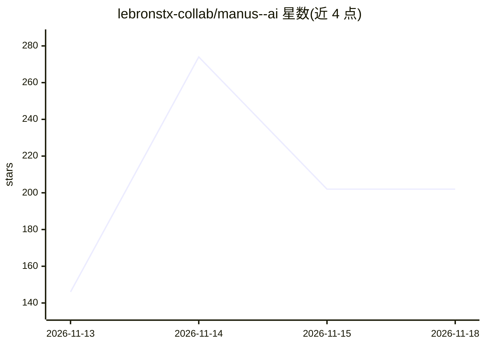

# lebronstx-collab/manus--ai

⭐ 202 · Apache-2.0 · 推送 2026-11-15 · [GitHub](https://github.com/lebronstx-collab/manus--ai) · 个人维护

**面向日常任务的自主 AI Agent，可执行代码并控制浏览器**

Manus 是一个自主 AI Agent，描述为可代用户编写并执行脚本、控制浏览器（导航网页、填写表单、抓取信息）并完成多步骤任务。定位为家庭、学习与轻量工作场景的个人助手，而非企业平台；会话间保持工作流一致性。README 提供配置与上手步骤说明及硬件兼容表（最低 4GB RAM、双核 CPU），但未给出具体安装命令、源码结构或技术实现细节，实际获取方式仅有 'Download Manus' 与口令字样。

## 筛选速览

| 维度 | 判定 | 备注 |
|---|---|---|
| AI 角色 | `ai-native` | 本体是模型或模型工具 |
| 许可风险 | `permissive` | Apache-2.0 |
| 部署形态 | `None` |  |
| 模型依赖 | — | README 未给出锁定关系 |
| 硬件要求 | — | 无带数字的原话,不猜 |
| 安装摩擦 | `low` | 无编译、无系统依赖或容器化 |
| 成熟度 | — | 结构信号不足 |

## 能力要点

- 自主执行代码完成多步骤任务
- 浏览器控制：导航、填表、信息采集
- 代码与浏览器操作在同一流程中衔接
- 面向家庭/学习/轻量工作的后台个人助手

## 适用场景

- 让代理解我完成重复性的脚本与网页操作
- 收集多网页信息并整理小结
- 学习与研究中组织笔记、跑小脚本

## 场景标签

`AI 助手` `浏览器自动化` · 领域:效率与自动化

## 证据(README 行号)

> L10: - **Autonomous Code Execution:** Manus AI agent runs code on its own to complete tasks, so you can focus on decisio
> L18: Manus is an autonomous AI agent designed to run code and control a browser on your behalf. Instead of acting like a

## 星数曲线

2026-11-13 146 → 2026-11-18 202（+56）

---
*卡片 v1 · prompt 1.4 · 生成 2026-11-17 · 置信度 low · 依据 README sha `0f78ee3a5dd2` · [字段定义](../../DATASET.md)*
