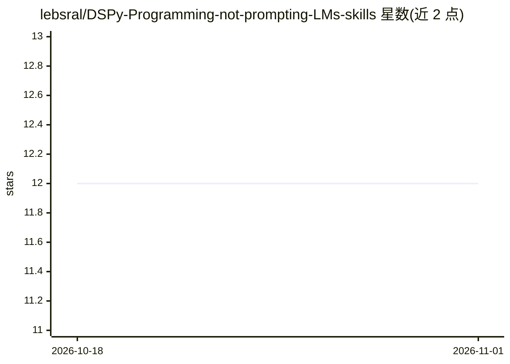

# lebsral/DSPy-Programming-not-prompting-LMs-skills

⭐ 12 · Python · 推送 2026-06-28 · [GitHub](https://github.com/lebsral/DSPy-Programming-not-prompting-LMs-skills) · 个人维护

**面向 Claude Code 等编程 agent 的 DSPy 技能包（约 60 个技能）**

一套可通过 npx skills add 安装到 Claude Code（亦兼容 Cursor 等编程 agent）的 AI 技能集合，围绕 DSPy 框架组织：入口技能 /ai-do 按问题描述路由到对应技能，其余技能覆盖 AI 项目脚手架、分类、RAG、Text-to-SQL、结构化解析、agent 协调、幻觉抑制、成本削减、微调、评测监控等开发场景，并含 DSPy 各模块/优化器的 API 参考技能及 Ollama、vLLM、Qdrant、Langfuse、MLflow 等工具的专项集成技能。技能在编程 agent 内以斜杠命令调用，生成可运行的提示与安装指引。

## 筛选速览

| 维度 | 判定 | 备注 |
|---|---|---|
| AI 角色 | `ai-ecosystem` | LLM/agent 周边工具 |
| 许可风险 | `none` | — |
| 部署形态 | `library` | 以包/库形式分发 |
| 模型依赖 | local-ok | 支持本地模型 |
| 硬件要求 | — | 无带数字的原话,不猜 |
| 安装摩擦 | `low` | 无编译、无系统依赖或容器化 |
| 成熟度 | — | 结构信号不足 |

## 能力要点

- /ai-do 入口技能按问题描述路由并生成可运行提示
- 覆盖约 40 个 AI 开发场景技能（RAG、分类、Text-to-SQL、评测、微调等）
- 约 30 个 DSPy 模块/优化器的 API 参考技能
- 针对 Ollama、vLLM、Qdrant、Langfuse、MLflow 等工具的专项集成技能

## 适用场景

- 在 Claude Code 里描述需求，让 agent 选技能并生成 DSPy 项目方案
- 为分类、RAG、文档问答等 AI 功能生成 DSPy 脚手架代码
- 本地 Ollama 或 vLLM 环境下搭建 DSPy 应用
- 排查 DSPy 代码反模式并选择合适的模块与优化器

## 场景标签

`提示工程` `代码生成` · 领域:Agent 开发

## 证据(README 行号)

> L3: Build reliable AI features. Powered by DSPy — a framework that lets you program language models with composable modu
> L10: npx skills add lebsral/DSPy-Programming-not-prompting-LMs-skills --skill ai-do
> L25: |"I want to build something with AI but not sure where to start"|`/ai-do`|Describe your problem, get routed to the 

## 星数曲线

2026-10-18 12 → 2026-11-01 12（+0）

---
*卡片 v1 · prompt 1.4 · 生成 2026-11-01 · 置信度 high · 依据 README sha `053eaa4c51dd` · [字段定义](../../DATASET.md)*
